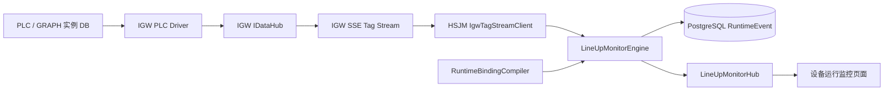
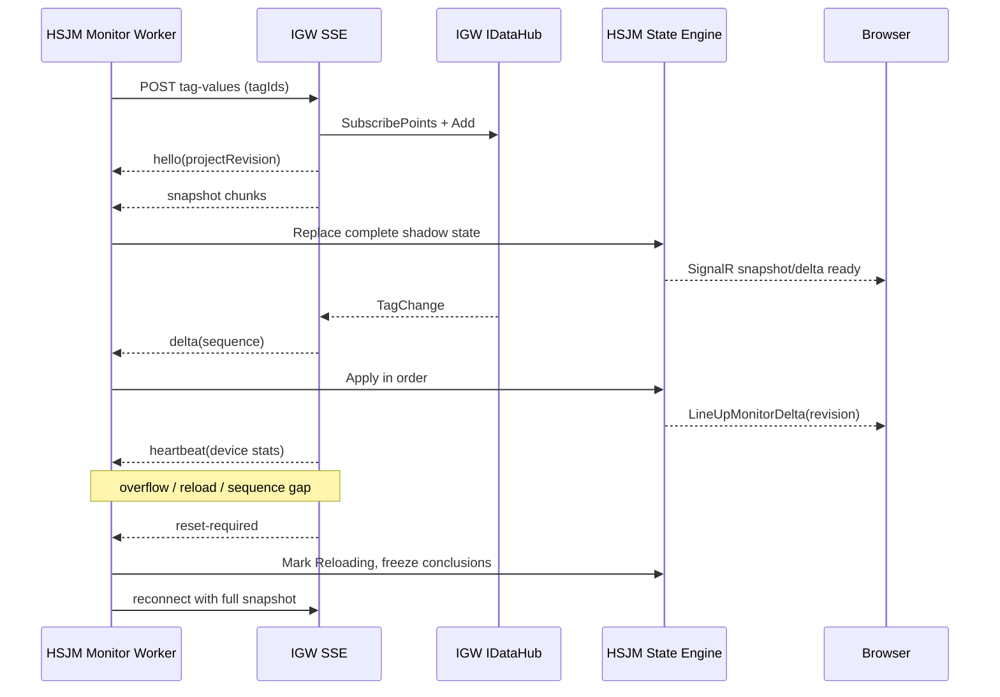

# LineUp 基于 IGW SSE 的实时设备监控技术设计

> 文档状态：待项目负责人审核；适用仓库：`E:\项目\IGW`、`E:\项目\HSJM_AI_PLC`；对应阶段：LineUp 迁移 Phase 2（实时绑定与设备运行监控）；前置能力：Phase 1 GRAPH 导入、层级审查、结构提交、博图式静态画布。

## 1. 背景与结论

LineUp 第一阶段已经把 GRAPH 导入、工序/工站/子工站识别、结构提交和静态流程图迁入 HSJM，但实时监控尚未接入。当前页面只能证明 GRAPH 结构是否正确，不能证明现场 PLC 正在执行哪个工步，也不能可靠显示转换条件、超时和异常定位。

本阶段采用以下确定方案：

- IGW 新增**通用、只读、与 LineUp 无关**的 PLC 点位 SSE 订阅接口。
- HSJM 在服务端连接 IGW，完成 GRAPH 到真实点位的绑定编译、状态计算、异常判断和历史记录。
- HSJM 前端继续使用现有 SignalR 技术栈，只订阅 HSJM 的 LineUp 状态，不直接访问 IGW。
- 原有“HSJM PLC 项目 / IGW 设备”绑定方式本阶段不重做；新能力消费现有设备选择结果。
- 不向 PLC 写值，不在 IGW 中创建工序、工站、子工站、GRAPH 或 LineUp 数据表。
- 不恢复 BOM 图片标记。

一句话数据流：

```text
PLC -> IGW 驱动/采集 -> IDataHub -> SSE 点位流 -> HSJM 状态引擎
    -> PostgreSQL 运行事件 + SignalR 增量 -> 浏览器博图式流程图
```

## 2. 设计目标

1. GRAPH 导入并确认结构后，能够把工步执行位和转换条件精确绑定到 IGW 点位。
2. 页面实时高亮当前工步，支持并行分支中的多个活动工步。
3. 显示转换条件的真、假、未知和质量异常，定位阻塞条件。
4. 显示工步超时、信号质量异常、IGW/PLC 离线和数据过期，禁止用旧值伪装“正在运行”。
5. 工步、工序、工站或子工站改显示名称后，实时绑定仍通过不可变身份取数。
6. 多个浏览器查看同一子工站时，不重复增加 IGW 订阅或 PLC 扫描负载。
7. 网络中断、慢消费者、IGW 工程热重载和服务重启后能够自动恢复，并先取得完整快照再继续增量。
8. 给另一位开发人员提供可直接落地的接口、数据模型、边界和验收标准。

## 3. 非目标

- 不把 LineUp 业务逻辑移动到 IGW。
- 不允许浏览器持有 IGW 用户名、密码或直接连接 IGW。
- 不在本阶段重构现有 PLC 项目/设备管理页面。
- 不在 IGW 中根据 GRAPH 自动创建业务数据库。
- 不通过可编辑的 `DisplayName` 做地址匹配、重导入匹配或状态关联。
- 不执行 PLC 控制、强制、写值或配方下发。
- 不把“条件为真”简单等同于“转换已经触发”。
- v1 不提供 SSE 历史重放；断线后一律重新取完整快照。
- v1 不支持多个 HSJM 监控工作进程同时消费同一绑定；部署时只能启用一个监控工作进程。

## 4. 现状证据与必须补齐的缺口

### 4.1 IGW 已有能力

IGW 已具备可复用的数据面：

- `IDataHub.SubscribePoints(...)` 和 `IPointSubscription.Add/Remove` 可订阅点位变化。
- 订阅点位会增加设备采集需求；在 active 扫描模式下，不需要 HSJM 额外轮询 `Touch`。
- 当前值模型已经包含点位 ID、值、质量、质量码、源时间和服务端时间。
- 每个 DataHub 订阅具有有界队列和丢弃计数，可作为背压监测依据。
- Runtime 已有 HTTP Basic 鉴权、读写权限和分支前缀权限。

但现有实现有四个缺口：

1. `/api/v1/values?ids=...` 是请求/响应读取，URL 长度和轮询频率不适合大量实时点位。
2. 现有鉴权把所有 `POST` 都当成写操作；新的只读流式 `POST` 必须单独分类。
3. 现有分支权限只检查 URL/query 中的 ID，无法覆盖请求体里的 `tagIds`。
4. DataHub 只在值或质量变化时发出 `TagChange`；值长期不变时，不能只靠 delta 判断 PLC 是否仍在采集。

### 4.2 HSJM 已有能力

HSJM 已具备：

- GRAPH 的 Sequence、Step、Transition、Action 和规范化 Edge 数据。
- `AI_LineUp_SubStationGraphBinding.RuntimeBindingJson`、`BindingStatus` 和 `LastValidatedAt` 字段。
- Step/Transition 的 `SourceVariablePath`、`BlockInterfaceId` 等绑定字段。
- `ai_plc_blockinterface` 中的真实 PLC 块接口、类型和偏移信息。
- SignalR 注册与现有 Hub 实现模式。
- LineUp 静态 GRAPH 画布、工作台路由和设备监控菜单。

当前仍缺少：

- Phase 1 没有把工步执行位写入 `SourceVariablePath/BlockInterfaceId`。
- Transition 原始 FlgNet 尚未编译成可安全执行的条件 AST 和引用点位集合。
- `RuntimeBindingJson` 还没有形成可用于监控的版本化绑定计划。
- 没有 IGW 长连接客户端、LineUp 状态引擎、运行事件表和 `/hubs/lineup-monitor`。
- 当前监控页显示结构数据，不得标记为“实时监控已接通”。

## 5. 总体架构



### 5.1 IGW 职责

- 鉴权并校验请求体中每个点位的读取权限。
- 从 `IDataHub` 取得初始快照和后续变化。
- 维持点位采集需求，输出 snapshot、delta、heartbeat 和 reset-required。
- 暴露设备连接、扫描和丢弃诊断。
- 在工程重载、队列溢出或 Hub 被替换时明确要求客户端重置。

### 5.2 HSJM 职责

- 根据已确认的 PLC 项目、GRAPH 块、实例 DB 和 `ai_plc_blockinterface` 编译运行绑定。
- 统一维护 IGW SSE 连接，不随浏览器数量创建额外订阅。
- 使用三态逻辑计算工步、转换、条件和异常状态。
- 持久化关键状态变化，向浏览器推送轻量增量。
- 在断线或修订号跳变时暂停结论、重建快照。

### 5.3 浏览器职责

- 获取流程定义与当前快照。
- 通过 SignalR 订阅某个子工站的状态增量。
- 检查快照修订号是否连续；发现缺口时重新获取快照。
- 只展示 HSJM 判定结果，不自行解析 PLC 地址或计算异常。

## 6. 为什么选 SSE，而不是 IGW SignalR 或原始 WebSocket

SSE 是本场景的首选：

- 数据方向是 IGW 到 HSJM 的单向事件流，符合 SSE 模型。
- 可直接使用 ASP.NET Core HTTP 管道、Basic 鉴权、取消令牌和代理配置。
- HSJM 可用 `HttpClient` 的 `ResponseHeadersRead` 流式读取，无需引入第二套 Hub 协议。
- 帧是可诊断的文本协议，现场抓包、日志关联和兼容性测试更简单。
- 控制动作仍通过普通 REST 完成，避免在同一长连接内混合读写语义。

不选 IGW SignalR：IGW 当前没有 SignalR 依赖，且会让通用网关绑定到 HSJM 的客户端技术栈。不选原始 WebSocket：需要自行设计握手、分帧、心跳和代理兼容，投入高但没有额外业务收益。

## 7. IGW SSE 接口契约

### 7.1 Endpoint

```http
POST /api/v1/streams/tag-values
Accept: text/event-stream
Content-Type: application/json
Authorization: Basic <server-side credential>
X-Correlation-ID: <uuid>
```

请求体：

```json
{
  "protocolVersion": 1,
  "clientId": "hsjm-lineup-instance-01",
  "tagIds": [
    "Channel1.PLC1.DB260_CacheGraph.RT_DATA.EXEC_BITS.EXEC_BITS[0]"
  ],
  "includeSnapshot": true,
  "heartbeatSeconds": 10
}
```

固定限制：

| 项目 | 限制 |
| --- | --- |
| `protocolVersion` | v1 只接受 `1` |
| `clientId` | 1～64 字符，只用于诊断，不能作为权限依据 |
| `tagIds` | 每条流 1～4096 个 |
| 单个 Tag ID | 最长 512 个 UTF-16 字符 |
| 请求体 | 最大 2 MiB |
| `heartbeatSeconds` | 5～30 秒，默认 10 秒 |
| 重复 ID | 大小写不敏感去重，按规范化 ID 确定性排序 |

当单个设备超过 4096 个监控点，HSJM 按规范化 Tag ID 排序后确定性分片。分片键必须稳定，重新启动不能随机改变。

### 7.2 建流前状态码

| 状态码 | 语义 |
| --- | --- |
| 400 | JSON、协议版本、字段或数量限制不合法 |
| 401 | 未认证 |
| 403 | 用户无读取权限，或任一 `tagId` 不在允许分支 |
| 409 | IGW 工程正在重载，暂时不能建立一致快照 |
| 503 | Runtime/Hub 尚未就绪或流功能未启用 |

一旦返回 `200` 并开始 SSE 响应，后续错误不再改变 HTTP 状态码，必须发送 `reset-required` 后关闭连接。

### 7.3 响应头

```http
Content-Type: text/event-stream; charset=utf-8
Cache-Control: no-store
Connection: keep-alive
X-Accel-Buffering: no
```

该 Endpoint 禁用响应缓冲和动态压缩，代理空闲超时必须大于 3 倍最大心跳间隔。

### 7.4 事件公共规则

- 所有时间使用 UTC ISO-8601，精度至少到毫秒。
- `id` 形式为 `<streamId>:<sequence>`。
- `sequence` 在单条连接内从 1 单调递增，不跨重连延续。
- `data` 是单行 JSON；实现必须限制单事件大小，拒绝无限缓存。
- `Last-Event-ID` 仅记录诊断信息，v1 不做历史重放。
- 每次重连都创建新的 `streamId` 并重新发送完整 snapshot。

### 7.5 `hello`

建流后的第一个事件：

```text
event: hello
id: 8f7f...:1
data: {"protocolVersion":1,"streamId":"8f7f...","projectName":"THEONE-PLC1","projectRevision":"sha256:...","acceptedTagCount":1,"missingTagIds":[],"serverTimeUtc":"2026-08-21T02:00:00.000Z"}
```

规则：

- `projectRevision` 使用 IGW 当前已加载工程的稳定内容修订号，不使用启动时间。
- 任一点位不存在时，仍可返回 `hello`，但必须列入 `missingTagIds`；HSJM 将对应绑定降级为 `NeedsReview/Unresolved`。
- `missingTagIds` 过多时也必须受响应体上限约束；达到上限则建流前返回 400。

### 7.6 `snapshot`

初始值按每批最多 256 个点位分块：

```text
event: snapshot
id: 8f7f...:2
data: {"chunkIndex":0,"chunkCount":1,"complete":true,"values":[{"id":"...","value":true,"valueKind":"Boolean","quality":"Good","qualityCode":192,"good":true,"sourceTs":"2026-08-21T02:00:00.100Z","serverTs":"2026-08-21T02:00:00.105Z"}]}
```

在收齐所有 chunk 且最后一块 `complete=true` 之前，HSJM 不得发布“实时已就绪”。点位无当前值时也要返回一项，质量为 Unknown/Bad，不得静默省略。

### 7.7 `delta`

```text
event: delta
id: 8f7f...:3
data: {"emittedAtUtc":"2026-08-21T02:00:00.250Z","values":[{"id":"...","value":false,"valueKind":"Boolean","quality":"Good","qualityCode":192,"good":true,"sourceTs":"2026-08-21T02:00:00.247Z","serverTs":"2026-08-21T02:00:00.249Z"}]}
```

允许在最多 50 ms 或 100 个变化内小批量合并，先达到任一条件即发送。不得跨点位重排同一点位自身的变化顺序。

### 7.8 `heartbeat`

```text
event: heartbeat
id: 8f7f...:4
data: {"serverTimeUtc":"2026-08-21T02:00:10.000Z","lastSequence":3,"projectRevision":"sha256:...","devices":[{"name":"Channel1.PLC1","state":"Connected","configuredMinPeriodMs":500,"lastScanCompletedAtUtc":"2026-08-21T02:00:09.900Z","lastGoodSampleAtUtc":"2026-08-21T02:00:09.900Z"}],"subscription":{"queued":0,"dropped":0}}
```

这是协议必需部分。原因是 DataHub 在值和质量都不变时不会发出 delta；只有心跳携带最近扫描与最近有效采样，HSJM 才能区分“稳定不变”和“采集已经停止”。

IGW 需要在通用 `DeviceStats` 中新增并维护：

- `LastScanCompletedAtUtc`：一次扫描完成的 UTC 时间，不代表数据质量良好。
- `LastGoodSampleAtUtc`：最近一次至少取得一个 Good 样本的 UTC 时间。

这两个字段属于通用设备诊断，不得包含 LineUp 名称或业务状态。

### 7.9 `reset-required`

```text
event: reset-required
id: 8f7f...:5
data: {"reason":"Overflow","message":"stream state is no longer lossless","serverTimeUtc":"2026-08-21T02:00:11.000Z"}
```

允许原因：

- `Overflow`：DataHub 或 Endpoint 本地队列发生丢弃。
- `ProjectReload`：工程修订号变化。
- `HubReplaced`：热重载后 `IDataHub` 实例变化。
- `ProtocolError`：服务端无法继续生成合法事件。
- `ServerStopping`：Runtime 正常停止。

发送后立即关闭连接。HSJM 进入“不可信/重建中”，重新连接并取得完整 snapshot。

## 8. IGW 实现约束

### 8.1 鉴权与分支权限

流式接口虽然使用 `POST`，但语义是只读。必须把当前“POST 即写操作”的判断改成基于 Endpoint 元数据或明确策略：

- 普通 PLC 写入 Endpoint 仍要求 `CanWrite=true`。
- `POST /api/v1/streams/tag-values` 只要求读取权限。
- 鉴权中间件把已认证用户放入受控的 `HttpContext` feature/items，Endpoint 不能重新解析或记录 Authorization。
- Endpoint 解析请求体后，对**每一个** `tagId` 检查 `ReadBranches`。
- 任一点无权时整条请求返回 403，不返回哪些点位存在，以免信息泄露。
- 日志只记录用户名称、clientId、数量、streamId、相关 ID 和结果，禁止记录密码或 Authorization 头。

### 8.2 背压

DataHub 回调不得等待网络发送：

1. 回调将 `TagChange` 写入 Endpoint 专用有界 Channel。
2. Channel 建议容量 8192，使用非阻塞 `TryWrite`。
3. `TryWrite` 失败时设置 overflow 标志；发送协程发出 `reset-required` 并断开。
4. 同时监视 DataHub 当前订阅的 dropped 计数；计数增加也必须重置。
5. 不允许静默 DropOldest 后继续推送，因为 HSJM 会在缺失变化的状态上得出错误结论。
6. 请求取消后必须 Dispose `IPointSubscription`、停止心跳并释放 Channel。

### 8.3 热重载

建流时捕获 `IDataHub` 实例标识和 `projectRevision`。任一变化都发送 `ProjectReload/HubReplaced` 并关闭。旧流不得自动跨工程修订继续工作。

### 8.4 功能开关

新增 IGW 设置：

```json
{
  "TagStream": {
    "Enabled": false,
    "MaxTagsPerStream": 4096,
    "MaxStreams": 32,
    "HeartbeatSeconds": 10
  }
}
```

首次发布默认关闭；完成安全和负载验证后在目标工程显式启用。限制必须在服务端执行，不能只依赖配置界面。

## 9. HSJM 运行绑定编译

### 9.1 绑定输入

每个 Sequence 的运行绑定必须同时具备：

- 已存在的 `LineId/ProcessId/StationId/SubStationId/DeviceId`。
- 唯一且同项目的 `PlcProjectId`、GRAPH `GraphBlockId`。
- 唯一且同项目的 `InstanceDbBlockId`。
- 与调用链、LogicUnit、CallPin 和 `ai_plc_blockinterface` 一致的地址证据。
- IGW 中可读取的规范 Tag ID。

绑定优先级：

1. 已持久化、仍能验证的 durable binding。
2. PLC 项目、GRAPH、调用块、LogicUnit、InstanceDB 和接口的完整精确证据链。
3. 精确项目名与设备/工站编码证据，仅作为候选，不足以直接 `Resolved`。
4. 其他模糊或多候选结果一律 `NeedsReview`，缺少基础证据则 `Unresolved`。

不得使用 `DisplayName`、字符串包含、`FirstOrDefault` 或“选最大的 DB”静默猜测。

### 9.2 工步执行位

保留旧 LineUp 已验证的 Siemens GRAPH 运行位规则：

```text
{InstanceDbName}.RT_DATA.EXEC_BITS.EXEC_BITS[StepNumber - 1]
```

例如工步 S20 对应数组下标 19。编译器必须：

- 验证 `StepNumber >= 1`。
- 在 `ai_plc_blockinterface` 中解析完整嵌套 STRUCT/ARRAY 路径和实际数据类型。
- 确认最终类型可转换为 Boolean。
- 写回 Step 的 `SourceVariablePath` 和 `BlockInterfaceId`。
- 生成 IGW 规范 Tag ID，并做一次只读可达性/质量验证。

公式只适用于已确认的 Siemens GRAPH InstanceDB。非 Siemens 或非标准布局不能套用，必须保持 `NeedsReview/Unresolved`。

### 9.3 转换条件

GRAPH XML 的 FlgNet 不能以字符串 `eval`、动态 C# 或 SQL 表达式执行。解析流程：

```text
FlgNet XML -> 白名单语法节点 -> 规范条件 AST -> 引用变量集合
           -> BlockInterface 精确解析 -> IGW Tag ID
```

v1 白名单至少支持：

- Boolean 常量、变量引用、上升/下降沿。
- `AND`、`OR`、`NOT`。
- 等于、不等于和基础数值比较。
- 括号/嵌套网络的确定性组合。

遇到未知指令、歧义端点、缺少变量、类型不兼容或地址不可读时：

- 保留原始来源证据用于诊断。
- Transition 状态为 `Unknown`。
- Binding 不得进入 `Resolved`。
- 页面显示具体未解析项，不能把 Unknown 当 False。

### 9.4 `RuntimeBindingJson` v1

`AI_LineUp_SubStationGraphBinding.RuntimeBindingJson` 使用版本化结构：

```json
{
  "schema": "lineup.runtime-binding.v1",
  "definitionRevision": "sha256:...",
  "plcProject": {
    "id": "457...",
    "sourceName": "THEONE-PLC1",
    "metadataRevision": "sha256:..."
  },
  "graph": {
    "blockId": "458...",
    "sourceKey": "block:FB260_CacheGraph",
    "instanceDbBlockId": "459..."
  },
  "igw": {
    "deviceId": "460...",
    "endpointKey": "existing-device-binding",
    "projectRevision": "sha256:..."
  },
  "tags": [
    {
      "role": "StepExecution",
      "ownerSourceKey": "sequence:0/step:20",
      "interfaceId": "461...",
      "canonicalSymbolicPath": "DB260_CacheGraph.RT_DATA.EXEC_BITS.EXEC_BITS[19]",
      "igwTagId": "Channel1.PLC1.DB260_CacheGraph.RT_DATA.EXEC_BITS.EXEC_BITS[19]",
      "dataType": "Bool",
      "expectedScanMs": 500
    }
  ],
  "transitionAsts": {
    "sequence:0/transition:2": {
      "operator": "AND",
      "arguments": [
        { "operator": "TAG", "tagRef": 3 },
        { "operator": "TAG", "tagRef": 4 }
      ]
    }
  },
  "compiledAtUtc": "2026-08-21T02:00:00.000Z"
}
```

约束：

- JSON 不存 IGW 密码、连接字符串或 Authorization。
- 所有 ID 以字符串序列化，避免 JavaScript 64 位整数精度损失。
- `ownerSourceKey`、数据库 ID 和原始名称参与稳定关联；`DisplayName` 只用于 UI。
- 任何源文件哈希、PLC 元数据修订或 IGW 工程修订变化都触发重新验证。

### 9.5 Binding 状态机

```text
Unresolved -> NeedsReview -> Resolved
Resolved --证据失效/工程变更/点位缺失--> NeedsReview
NeedsReview --基础对象被删除--> Unresolved
```

只有以下条件全部满足才能 `Resolved`：

- 每个工步执行位精确解析、类型正确且 IGW 可读。
- 所有参与实时判断的转换条件都已编译；不支持的条件被明确排除监控时必须由用户确认。
- 运行计划中的所有 Tag ID 均通过 IGW 权限与存在性校验。
- `definitionRevision`、PLC metadata revision 和 IGW project revision 已记录。
- `LastValidatedAt` 更新为本次服务端验证完成时间。

## 10. HSJM SSE 客户端与订阅协调器

### 10.1 `IgwTagStreamClient`

使用 `HttpClient.SendAsync(request, ResponseHeadersRead, cancellationToken)`，逐行解析 SSE：

- 每行、每事件和累计 snapshot 都有大小上限。
- 只接受 UTF-8、已知 event 名称和 `protocolVersion=1`。
- 拒绝倒退/重复的 sequence、错误 chunk、缺失 complete 和非法 JSON。
- 取消时立即释放 Response stream 和 HTTP request。
- 认证信息来自 HSJM 服务端安全配置，不能返回 DTO 或写入日志。

### 10.2 `LineUpIgwSubscriptionCoordinator`

- 按 `(IGW endpoint, IGW device, shard)` 维护一条共享流。
- 聚合所有已启用、`Resolved` 绑定的 Tag ID 并去重。
- 浏览器订阅数只影响 SignalR group，不改变 IGW 点位流。
- 绑定计划变化后做短暂防抖，关闭旧流并用新 Tag 集合建立快照。
- 重试采用带随机抖动的指数退避：1、2、5、10、30 秒封顶。
- 收到 401/403 不无限快速重试，进入配置错误并产生告警事件。
- 收到 reset、sequence gap 或解析错误时冻结运行结论，重连后以完整 snapshot 替换旧影子状态。

### 10.3 单工作进程约束

v1 只允许一个 HSJM `LineUpMonitorWorker` 运行。若 API 未来横向扩容，必须先完成以下任一能力再启用多工作进程：

- 数据库/Redis 分布式租约，确保同一绑定只有一个 owner；以及
- SignalR backplane，使其他 API 实例能够接收状态增量。

在此之前，部署配置必须显式区分 API 实例与唯一 Monitor Worker，防止重复事件和重复 IGW 订阅。

## 11. LineUp 状态引擎

### 11.1 内部影子状态

每个子工站维护：

- `definitionRevision`：GRAPH 和 RuntimeBinding 的稳定修订。
- `snapshotRevision`：HSJM 内单调递增的状态版本。
- Gateway 状态：`Connecting/Online/Degraded/Offline/Reloading/ConfigurationError`。
- 活动工步集合，而不是单一 CurrentStep。
- 每个 Step/Transition/Condition 的当前状态、质量、变化时间和持续时长。
- 最近一次完整 IGW snapshot、streamId 和 sequence。

### 11.2 三态逻辑

PLC 条件必须用 `True/False/Unknown`：

| 输入 | NOT | AND 关键规则 | OR 关键规则 |
| --- | --- | --- | --- |
| True | False | 全 True 才 True | 任一 True 即 True |
| False | True | 任一 False 即 False | 全 False 才 False |
| Unknown | Unknown | 无 False 且含 Unknown 为 Unknown | 无 True 且含 Unknown 为 Unknown |

Bad、Uncertain、缺值、过期、断流或未解析都映射为 Unknown。Unknown 不能触发“条件未满足导致停机”的确定结论，只能显示“无法判断/信号异常”。

### 11.3 工步状态

- Good 且执行位 True：`Active`。
- Good 且由 True 变 False：记录 `Exited`，转为 `Completed` 或 `Idle` 由拓扑事件判断。
- Bad/过期/断流：`Unknown`，保留最后有效值及时间但视觉降级。
- 同一并行分支允许多个 Step 同时 `Active`。
- 多个互斥选择分支同时 Active 是结构/信号异常，记录 `ConflictingActiveSteps`。

### 11.4 转换状态

- 条件 AST 计算 True：`Satisfied`。
- 条件 AST 计算 False：`Unsatisfied`。
- 任一必要输入不可判断：`Unknown`。
- `JustFired` 不能仅由条件 True 得出；需要上游 Step 退出、下游 Step 进入和拓扑关系在同一有效时间窗口内一致。
- 并行 split/merge 按规范化 Edge 的分支语义计算，不能把图压成单链。
- Jump 使用目标 SourceKey 关联，不使用画布坐标。

### 11.5 超时

- 解析 Step 的 `WarningTime`、`MaximumStepTime`，只接受白名单 TIA 时间字面量。
- 持续时间计算使用单调时钟；落库时间使用 UTC。
- 达到 WarningTime：`Warning`，橙色提示。
- 达到 MaximumStepTime：`TimedOut`，红色异常并记录事件。
- 网络断流/Unknown 期间暂停确定性超时结论；恢复后根据有效样本和单调时间重新校准，不把断网时间直接算作工步卡滞。

## 12. 在线、过期与异常语义

默认心跳 10 秒时：

| 条件 | HSJM 状态 | 页面行为 |
| --- | --- | --- |
| 正常收到心跳、设备 Connected、最近 Good 采样正常 | Online | 正常高亮 |
| 设备 Connected，但 `LastGoodSampleAtUtc` 超过 `max(3 × configuredMinPeriod, 15s)` | Degraded | 黄色横幅，状态按 Unknown 处理 |
| 连续 35 秒无合法 heartbeat | Offline | 灰化最后状态，显示最后有效时间 |
| 收到 Bad quality | Degraded | 对应点和条件显示质量异常，不判 False |
| sequence 跳号或 queue dropped 增加 | Reloading | 冻结结论，立即重建快照 |
| projectRevision 变化 | Reloading | 关闭旧流、重新验证绑定 |
| 401/403 | ConfigurationError | 明确提示凭据/权限配置错误，不频繁重试 |

点位 delta 的 `sourceTs` 不能单独作为静态信号的过期依据，因为值不变时不会产生 delta。在线判断以 heartbeat 的设备扫描诊断为主，以点位质量和最后有效变化时间为辅。

## 13. 持久化设计

### 13.1 复用现有表

- `AI_LineUp_SubStationGraphBinding`：保存版本化 `RuntimeBindingJson`、状态和验证时间；新增 `MonitoringEnabled boolean not null default false`，作为按绑定灰度启用的服务端开关。
- `AI_LineUp_GraphStep`：补写 `SourceVariablePath`、`BlockInterfaceId`。
- `AI_LineUp_GraphTransition`：补写规范表达式、条件 AST JSON、来源路径和接口 ID；多点条件的完整引用放入 RuntimeBinding。

### 13.2 新增 `AI_LineUp_RuntimeEvent`

只保存有业务价值的状态变化，不按每次 PLC 扫描落库：

| 字段 | 类型/规则 |
| --- | --- |
| `Id` | bigint 主键 |
| `BindingId` | bigint，所属子工站 GRAPH 绑定 |
| `SequenceId` | bigint |
| `OwnerSourceKey` | varchar，不可变 Step/Transition/Condition 身份 |
| `EventType` | varchar，白名单枚举 |
| `PreviousState` / `CurrentState` | varchar，可空 |
| `OccurredAtUtc` | timestamptz |
| `DurationMs` | bigint，可空 |
| `Quality` / `QualityCode` | varchar/int，可空 |
| `DefinitionRevision` | varchar |
| `GatewayStreamId` | varchar |
| `GatewaySequence` | bigint |
| `EventOrdinal` | int，同一 gateway sequence 内的确定性序号 |
| `DetailsJson` | jsonb，脱敏后的条件/异常详情 |

活跃唯一/幂等约束：

```text
(BindingId, GatewayStreamId, GatewaySequence, EventOrdinal)
```

主要 `EventType`：

- `StepEntered`、`StepExited`
- `TransitionSatisfied`、`TransitionFired`
- `StepWarning`、`StepTimedOut`、`TimeoutCleared`
- `SignalBad`、`SignalRecovered`
- `GatewayOffline`、`GatewayRecovered`
- `BindingInvalidated`
- `ConflictingActiveSteps`

v1 当前快照保存在内存，不新增快照表。服务重启后通过 IGW 完整 snapshot 重建，避免维护双重真相。

`MonitoringEnabled` 只有在 `BindingStatus=Resolved` 时才能设为 true；绑定降级、源修订变化或验证失败时，服务端必须自动关闭它，不能继续消费旧运行计划。

### 13.3 保留策略

- RuntimeEvent 建议在线保留 90 天，之后按现场要求归档或分区清理。
- 事件清理不得删除 GRAPH 定义和 RuntimeBinding。
- 日志和事件 JSON 不得存凭据、完整连接字符串或 Authorization。

## 14. HSJM API 与 SignalR 契约

### 14.1 REST API

```text
GET  /LineUp/Monitor/{subStationId}/Definition
GET  /LineUp/Monitor/{subStationId}/Snapshot
GET  /LineUp/Monitor/{subStationId}/Events?cursor=<id>&limit=100
POST /LineUp/Monitor/{subStationId}/ValidateBinding
```

- `Definition` 返回 GRAPH 节点/边、不可变 SourceKey、显示名称和 definitionRevision。
- `Snapshot` 返回 gateway 状态、snapshotRevision、活动工步和所有可视状态。
- `Events` 使用稳定游标分页，不用页码跨实时写入翻页。
- `ValidateBinding` 只执行读取和编译验证，不写 PLC；需要管理权限。
- DTO 中所有 long ID 序列化为字符串。
- 不返回 IGW 密码、数据库连接、内部异常堆栈和 `RuntimeBindingJson` 中的内部安全字段。

### 14.2 SignalR Hub

路径：

```text
/hubs/lineup-monitor
```

客户端方法：

```text
SubscribeSubStation(subStationId, knownDefinitionRevision, knownSnapshotRevision)
UnsubscribeSubStation(subStationId)
```

服务端消息：

```text
LineUpMonitorDelta
LineUpSnapshotRequired
LineUpGatewayStatusChanged
```

`LineUpMonitorDelta` 必须携带：

- `subStationId`
- `definitionRevision`
- `fromSnapshotRevision`
- `toSnapshotRevision`
- 变化的节点、转换、条件和 gateway 状态

如果客户端已知 revision 与服务端不连续，服务端发送 `LineUpSnapshotRequired`，客户端重新 GET Snapshot，不尝试猜测缺失状态。

## 15. 前端交互设计

设备运行监控仍是网站中的功能页，菜单位置保持：

```text
停机分析
└─ 设备监控
   ├─ 设备运行监控
   ├─ GRAPH 导入工作台
   └─ 后续配置/历史入口
```

页面布局：

- 左侧：产线、工序、工站、子工站树；大量工站使用虚拟滚动和搜索，不把页面横向撑开。
- 中间：博图式 GRAPH 画布，使用已有 X6 规范化 Edge，保证 Step、Transition、split、merge、Jump 真正连通。
- 右侧：可折叠、可调整宽度的属性/异常抽屉；它是 Grid 列或窄屏下移区域，不覆盖画布。
- 底部/侧栏：最近事件和异常时间线。

颜色语义：

| 状态 | 颜色/效果 |
| --- | --- |
| 当前 Active Step | 绿色实心 + 轻微脉冲 |
| 刚触发 Transition | 青色短时高亮 |
| Warning | 橙色 |
| Timeout/确定异常 | 红色 |
| Unknown/Offline | 灰色、降低饱和度 |
| Bad quality | 红色描边 + 质量图标 |
| 最后有效但已断流 | 保留形状、整体灰化并显示时间 |

用户选择节点时，右侧展示：原始 SourceName、可编辑 DisplayName、SourceKey、PLC 规范路径、IGW Tag ID 的脱敏显示、当前值、质量、更新时间、条件拆解和最近事件。改名不修改 SourceKey、接口 ID 或 Tag ID。

## 16. 关键运行时序



浏览器首次进入的顺序固定为：

1. GET Definition。
2. GET Snapshot。
3. 建立 SignalR 并订阅子工站。
4. 如果订阅响应表明 revision 已变化，重新 GET Snapshot。
5. 后续只应用连续 delta；发现缺口立即重取快照。

## 17. 配置建议

HSJM 新增服务端配置模型，密钥由现有安全配置/环境注入，不进入数据库业务表：

```json
{
  "LineUpMonitoring": {
    "Enabled": false,
    "WorkerInstanceId": "lineup-monitor-01",
    "HeartbeatTimeoutSeconds": 35,
    "ReconnectMaxSeconds": 30,
    "SnapshotMaxBytes": 8388608,
    "EventRetentionDays": 90
  }
}
```

IGW endpoint 和凭据继续来自现有 HSJM PLC/IGW 设备绑定或其安全配置来源。本阶段不得建立第二套人工重复映射页面。

## 18. 建议代码落点

### 18.1 IGW

```text
src/IGW.Northbound.RestApi/TagValueStreamContracts.cs
src/IGW.Northbound.RestApi/TagValueStreamApi.cs
src/IGW.Northbound.RestApi/PublicPlcApiPolicy.cs
src/IGW.Runtime/Program.cs
src/IGW.Core/Engine.cs
tests/IGW.Tests/TagValueStreamApiTests.cs
tests/IGW.Tests/PublicPlcApiPolicyTests.cs
```

Endpoint 应作为 Northbound 的通用 tag-values 能力，不能引用 HSJM 或 LineUp 程序集。

### 18.2 HSJM

```text
api/HSJM.AI.IDbService/Models/LineUp/LineUpRuntimeEventEntity.cs
api/HSJM.AI.IDbService/IService/LineUp/ILineUpMonitoringRepository.cs
api/HSJM.AI.DbService/Service/LineUp/LineUpMonitoringRepository.cs
api/HSJM.AI.AppLayer/LineUp/Monitoring/IgwTagStreamClient.cs
api/HSJM.AI.AppLayer/LineUp/Monitoring/LineUpRuntimeBindingCompiler.cs
api/HSJM.AI.AppLayer/LineUp/Monitoring/LineUpIgwSubscriptionCoordinator.cs
api/HSJM.AI.AppLayer/LineUp/Monitoring/LineUpMonitorEngine.cs
api/HSJM.AI.AppLayer/LineUp/Monitoring/LineUpMonitorWorker.cs
api/HSJM.AI.AppLayer/LineUp/Monitoring/LineUpMonitorHub.cs
api/HSJM.AI/Controllers/LineUp/LineUpMonitorController.cs
web/src/api/modules/LineUp/monitor.ts
web/src/views/LineUp/monitor/index.vue
```

具体命名可按仓库依赖方向微调，但必须保持“协议客户端、绑定编译、状态引擎、持久化、Web 契约”分层，避免把全部逻辑塞入 Controller 或 Vue 页面。

## 19. 测试设计

### 19.1 IGW 单元/契约测试

- 只读 POST 不要求 `CanWrite`，写入 POST 仍要求。
- 请求体内每个 Tag ID 都执行 ReadBranches 检查。
- 400/401/403/409/503 状态和响应脱敏。
- tag 数量、ID 长度、body 大小、heartbeat 和 protocolVersion 限制。
- hello 必须第一个、snapshot 分块完整、sequence 单调。
- 值改变产生 delta；值不变仍持续 heartbeat 且更新时间推进。
- Bad quality 正确传输，不改写成 False/0。
- Endpoint Channel 或 DataHub drop 后发送 reset-required 并断开。
- 工程热重载/Hub 替换后 reset。
- 客户端取消后订阅、Channel 和心跳全部释放。
- 慢客户端不会造成无限内存增长或阻塞 PLC 发布线程。

### 19.2 IGW 集成测试

使用模拟驱动建立至少两个 Bool 和一个数值点：

- 完整 snapshot -> delta -> heartbeat。
- 长时间不变的 Good 点保持在线。
- PLC 断开、恢复和质量变化。
- 重新连接得到新 streamId 和完整 snapshot。
- 4096 点压力与 32 条流上限。

### 19.3 HSJM 单元测试

- SSE parser：分块读取、CRLF/LF、非法 UTF-8、超长事件、非法 JSON、未知 event。
- stream sequence：重复、倒退、跳号、reset 和 reconnect。
- StepNumber 到 EXEC_BITS 下标的边界和真实 FB260 样例。
- 嵌套 STRUCT/ARRAY 接口精确解析，禁止最大 DB/模糊名字猜测。
- FlgNet 到 AST 的 AND/OR/NOT/比较/边沿及不支持指令。
- True/False/Unknown 三态真值表。
- 并行活动工步、选择分支冲突、split/merge 和 Jump。
- Warning/Timeout、断流期间不误判、恢复后校准。
- RuntimeEvent 幂等键和数据库事务。
- 多浏览器订阅不增加 IGW stream 数量。

### 19.4 API、SignalR 和前端测试

- Definition/Snapshot revision 一致性。
- SignalR delta 缺口触发 SnapshotRequired。
- JWT/业务权限和 DTO 脱敏。
- 页面 Online、Degraded、Offline、Unknown、Timeout 状态。
- 右侧抽屉不遮挡画布，窄屏下移。
- 大量工站/Sequence 使用虚拟滚动，不撑开布局。
- DisplayName 修改后 SourceKey 与实时状态仍能匹配。

### 19.5 真实环境验收

必须在目标环境完成，不能用源码检查代替：

1. 使用真实 IGW 工程确认 Endpoint、鉴权和 ReadBranches。
2. 使用真实 PLC 或可控模拟器确认至少一个 GRAPH Sequence 跑动。
3. 对照 TIA Portal Online 视图，核对活动 Step 和转换条件。
4. 人为断开 PLC、停止 IGW、切换网络，确认页面不显示虚假运行状态。
5. 让信号保持不变至少 5 分钟，确认心跳仍判在线。
6. 同时打开多浏览器，确认 IGW 订阅数和 PLC 采集需求没有按浏览器倍增。
7. 修改显示名称并重载页面，确认地址与历史仍关联到原 SourceKey。
8. 导出运行事件，核对进入、退出、超时和离线时间。

## 20. 性能与容量验收

建议 v1 验收门槛：

- 单条 SSE 支持 4096 点，Endpoint 内存有明确上限。
- 典型 500 ms 扫描下，IGW 到 HSJM 的 P95 增量延迟不高于 1 秒。
- 20 个浏览器查看同一子工站时，IGW stream 数量不增加。
- 慢消费者只导致该流 reset，不影响 DataHub/PLC 采集循环。
- RuntimeEvent 仅记录状态变化，不按扫描周期写库。
- HSJM/IGW 任一重启后 60 秒内恢复完整快照；凭据错误除外。

这些数值必须由集成/负载测试报告确认后才能作为“通过”，不能只写在配置中。

## 21. 安全要求

- IGW 使用最小权限的只读服务用户；禁用 PLC 写权限。
- 每个请求体 Tag ID 都做分支授权，不能只检查 URL。
- 浏览器永远不接触 IGW 凭据和内部 endpoint。
- 密钥只通过安全配置或环境注入，不提交 Git、不写 RuntimeBindingJson、不打印日志。
- SSE/SignalR/REST 都限制消息大小、集合数量和字符串长度。
- 条件 AST 只解释白名单节点，不执行任意代码。
- 错误响应不暴露工程物理路径、调用栈、密码、连接字符串或其他分支的点位。
- 本阶段所有 PLC 操作均为读取。

## 22. 发布与回退

按以下门禁顺序发布：

1. 先发布 IGW 通用 SSE Endpoint，功能开关保持关闭。
2. 用模拟工程完成安全、协议、稳定不变信号和慢消费者验证。
3. 在目标 IGW 仅为只读服务用户启用 Endpoint。
4. 发布 HSJM RuntimeBinding 编译器，以 shadow mode 验证绑定但不驱动正式页面。
5. 将 HSJM 判定与旧 LineUp/TIA Portal Online 结果并行对照。
6. 按产线/设备逐个启用 `LineUpMonitoring.Enabled` 和绑定。
7. 验收完成后再把设备运行监控标记为正式实时功能。

回退方式：

- 在 HSJM 禁用 Monitor Worker，页面退回静态结构/明确的“实时未启用”。
- IGW SSE Endpoint 可保留但关闭功能开关，不影响原 REST、OPC UA 或驱动采集。
- 不回滚 GRAPH 结构和用户修改的 DisplayName。
- RuntimeEvent 为追加数据，可保留用于问题分析。

## 23. 开发完成定义

只有同时满足以下条件，本阶段才能宣称完成：

- IGW 通用 SSE 协议、鉴权、分支授权、背压和热重载测试通过。
- HSJM 对真实 GRAPH 生成可复核的 RuntimeBinding，所有 Resolved 点位可从 IGW 读取。
- 前端能够显示真实活动工步、并行分支、条件三态、超时和离线。
- 断流、Bad quality、稳定不变信号和 revision gap 均无误判。
- 多浏览器不导致重复 IGW 订阅。
- 真实环境与 TIA Portal Online 对照验收通过。
- 文档、数据库 DDL、配置示例、测试报告和回退说明同步更新。

## 24. 后续实施计划边界

本文件是技术规格，不是逐任务实施清单。审核本设计后，再单独生成开发计划，至少拆分为：

1. IGW SSE 协议与安全边界。
2. IGW 设备新鲜度诊断与集成测试。
3. HSJM RuntimeBinding 编译和持久化。
4. HSJM SSE 客户端、协调器和状态引擎。
5. RuntimeEvent、REST 和 SignalR。
6. 前端实时状态与异常定位。
7. 负载、安全、真实 PLC 联调和分阶段发布。

开发人员不得越过前一阶段的验证门禁直接宣称下一阶段完成。
