# IGW 工业网关 架构与流程分析

> 本文档基于源码梳理 IGW 的设计目标、整体架构、业务/数据/控制流程。所有流程图用 Mermaid 描述，可在支持 Mermaid 的 Markdown 查看器中渲染。

## 一、项目概览

### 1.1 设计目标

IGW（Industrial Gateway，工业网关）对标 KEPServerEX，定位为一款**跨平台、可热重载、支持百万点位的工业数据中转网关**。核心职责是把南向 PLC / 设备 / MQTT 设备的数据采集到本地缓存（DataHub），再通过多种北向协议（OPC UA Server、MQTT、REST、MES HTTP）统一对外发布，并提供配置、监控、报警、计算、历史记录、计划任务等工厂网关标准能力。

设计目标要点（源自代码注释与目录命名）：

- **对标 KEP**：OPC UA Server、IoT/MQTT 发布、Advanced Tags 计算、Data Logger、Scheduler、User Manager/Security、报警等功能均对标 KEP。
- **热重载**：`GatewayHost` 支持下发新配置后整体或增量重建，南向不变时只重建北向，设备不断线、缓存不丢。
- **百万点位**：DataHub 采用按句柄寻址、按点注册订阅、active-tag 按需采集，避免穿透 PLC。
- **跨平台**：Windows 服务（SCM）与 Linux systemd 同一套代码；Web 配置界面内嵌 Vue 产物。
- **授权控制**：未授权/过期时只保留 REST 以便激活，不采集、不北向。
- **现场可用性**：熔断、退避重连、自动降级、主备路径冗余回切、通道级自动重连。

### 1.2 技术栈

- 后端：.NET（`IGW.Runtime` 目标 `.net10.0-windows`，含 WPF 托盘/配置工具），ASP.NET Core Minimal API + Swagger。
- 驱动依赖：IoTClient（Modbus/Siemens/Omron FINS/AB/Mitsubishi）、libplctag（EtherNet/IP）、OPC.Ua.Client/SDK、MQTTnet。
- 前端：Vue 3 + Vite + TypeScript + Pinia + Element Plus。
- 数据存储：SQLite（历史/MES 日志/凭证）、`%ProgramData%\IGW` 作为可写数据根。
- 服务化：`UseWindowsService` + `UseSystemd`，同一可执行文件双形态运行。

### 1.3 解决方案结构（IGW.slnx）

| 层 | 项目 | 职责 |
|----|------|------|
| 抽象 | IGW.Abstractions | 接口契约 + 工程数据模型 + DataHub 抽象 |
| 核心 | IGW.Core | 采集引擎、设备循环、驱动注册表、地址块合并、报警/计算/计划/日志引擎 |
| 运行时 | IGW.Runtime | 宿主编排、授权、REST 挂载、入口 Program |
| 南向驱动 | IGW.Drivers.IoTClient / EtherNetIP / OpcUaClient / Mitsubishi / Mqtt / Simulator | 各协议设备接入 |
| 北向 | IGW.Northbound.RestApi / OpcUaServer / Mqtt / Mes | 对外发布与上报 |
| 应用 | IGW.WebUi(Vue) / IGW.Licensing / IGW.DbSetup / IGW.DataMover | Web 管理、授权、数据库配置、数据迁移 |

---

## 二、整体分层架构

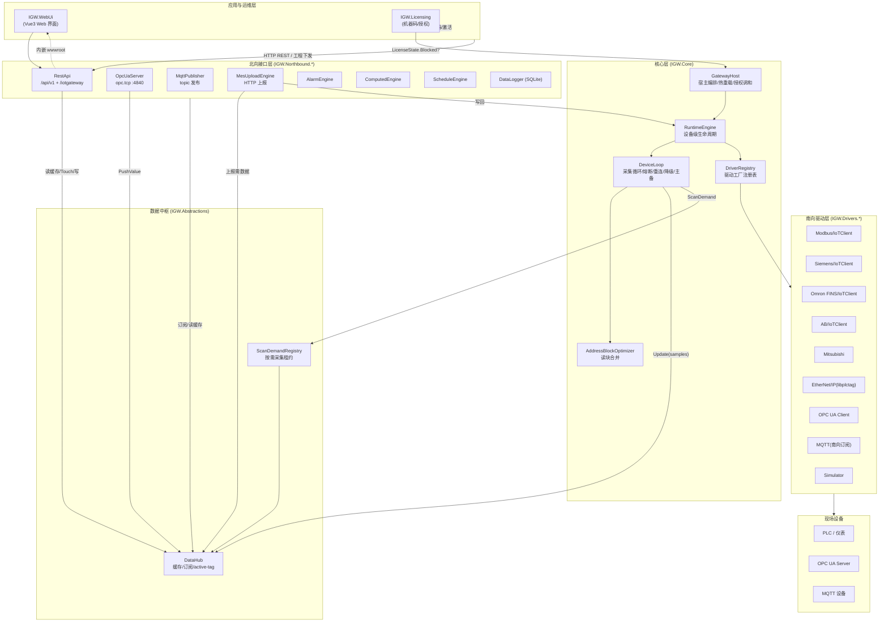

> 关键说明：`DataHub` 是唯一的数据中枢，南向只写、北向只读/订阅，避免任何北向穿透 PLC。`GatewayHost` 是编排核心，统一持有 Hub/Engine 与各北向组件。

---

## 三、核心数据模型

工程文件 `.igwproj` 的层级结构与运行时中枢：

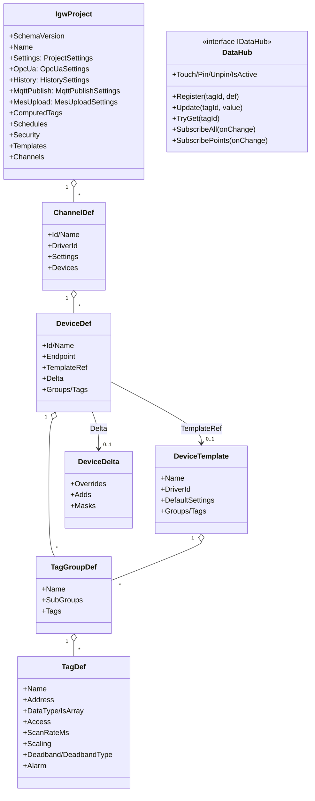

> 层级：**Project → Channel → Device → (Group*) → Tag**。Tag 是北向【分组路径】↔ 南向【PLC 地址】的绑定。模板实例通过 `Delta`（覆盖/追加/屏蔽）运行时展开，不落全量拷贝。

---

## 四、业务流程

### 4.1 网关启动流程

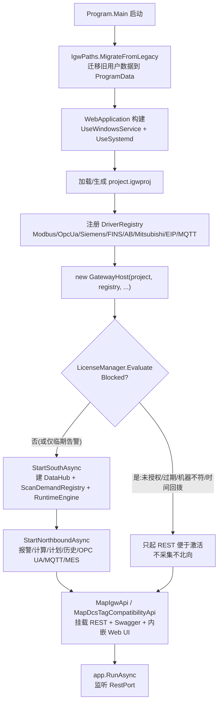

入口：[Program.cs:14-87](file:///d:/AI/AIProject/IGW/src/IGW.Runtime/Program.cs)。授权闸门：[GatewayHost.cs:134-149](file:///d:/AI/AIProject/IGW/src/IGW.Runtime/GatewayHost.cs)。

### 4.2 设备采集循环（含熔断/重连/降级/主备）

`DeviceLoop` 是每设备一条后台任务的主循环，集连接管理、扫描计划、熔断器、退避重连、自动降级、主备冗余于一体：

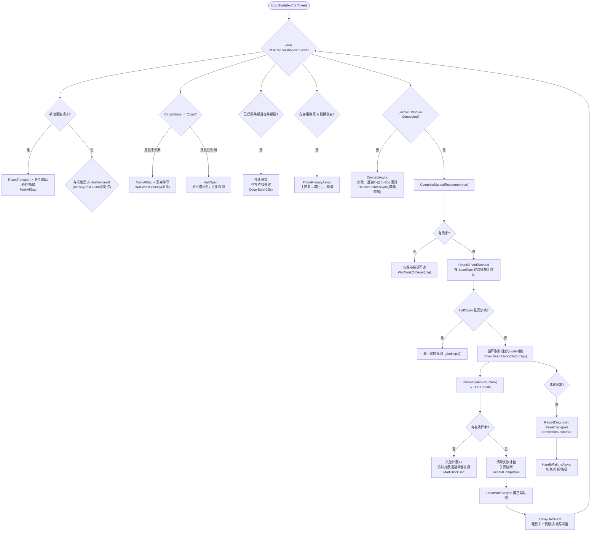

关键源码：[Engine.cs:267-500](file:///d:/AI/AIProject/IGW/src/IGW.Core/Engine.cs)（DeviceLoop 主循环）。

控制要点：
- **会话与扫描解耦**：设备启用即建立连接（反映真实在线/离线），需求只决定是否读取点位。
- **熔断器**：连续失败达阈值 → Open（阻塞 + 丢弃待写），到期 → HalfOpen 单次探测，成功 → Closed。
- **退避抖动**：1~5s 范围 ×(0.7~1.3) 抖动，避免全场锁步；读成功才复位退避。
- **自动降级**：连续故障达 `demoteAfter` → 降级期停采集（对齐 KEP「故障时降级」）。
- **主备冗余**：备用路径时定期探测主路径，恢复则切回（对齐 KEP「尽快返回至主要设备」）。
- **active-tag**：没人引用的点不去轮设备，由 `Touch/Pin/IsActive` 控制。

### 4.3 南向设备建立流程（StartDevice）

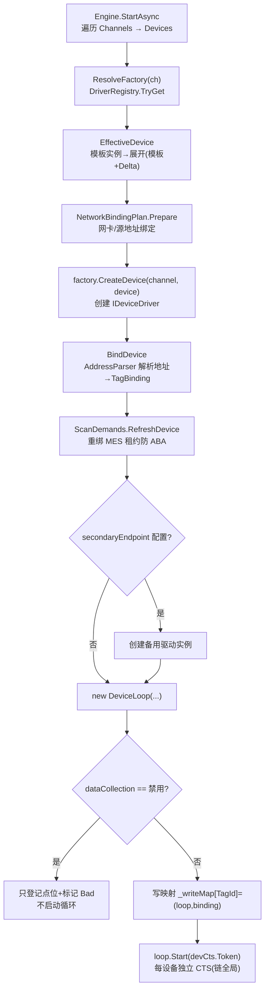

源码：[Engine.cs:938-1074](file:///d:/AI/AIProject/IGW/src/IGW.Core/Engine.cs)。

### 4.4 北向上报流程（四通道）

各北向组件统一订阅 DataHub，但触发方式不同：

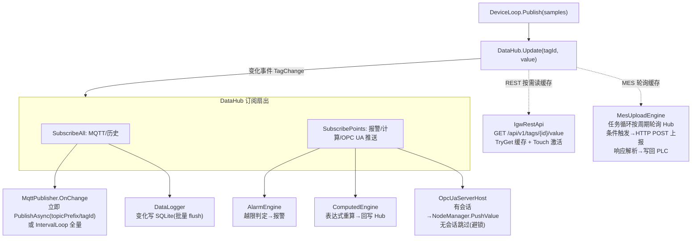

源码：MQTT [MqttPublisher.cs:38-90](file:///d:/AI/AIProject/IGW/src/IGW.Northbound.Mqtt/MqttPublisher.cs)；OPC UA [OpcUaServerHost.cs:58-65](file:///d:/AI/AIProject/IGW/src/IGW.Northbound.OpcUaServer/OpcUaServerHost.cs)；MES [MesUploadEngine.cs:141-189](file:///d:/AI/AIProject/IGW/src/IGW.Northbound.Mes/MesUploadEngine.cs)；REST [IgwRestApi.cs:57-215](file:///d:/AI/AIProject/IGW/src/IGW.Northbound.RestApi/IgwRestApi.cs)。

MES 任务循环细化：

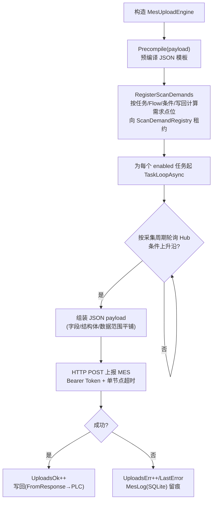

### 4.5 写入流程（北向下发 → PLC）

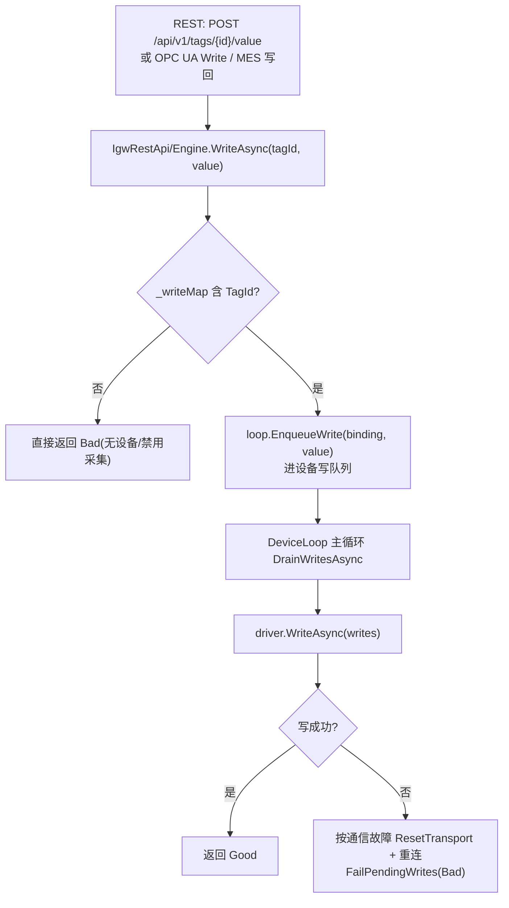

写优化：与读取共用单连接串行执行，无并发竞争；写请求可提前唤醒退避中的循环。

### 4.6 热重载流程（下发新配置）

`GatewayHost.ReloadAsync` 是配置生效的核心，体现"南向不变增量、北向总重建"策略：

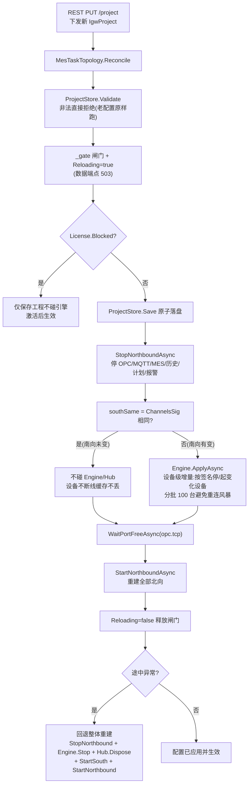

源码：[GatewayHost.cs:284-337](file:///d:/AI/AIProject/IGW/src/IGW.Runtime/GatewayHost.cs)；增量应用 [Engine.cs:1077-1115](file:///d:/AI/AIProject/IGW/src/IGW.Core/Engine.cs)。

### 4.7 授权生命周期

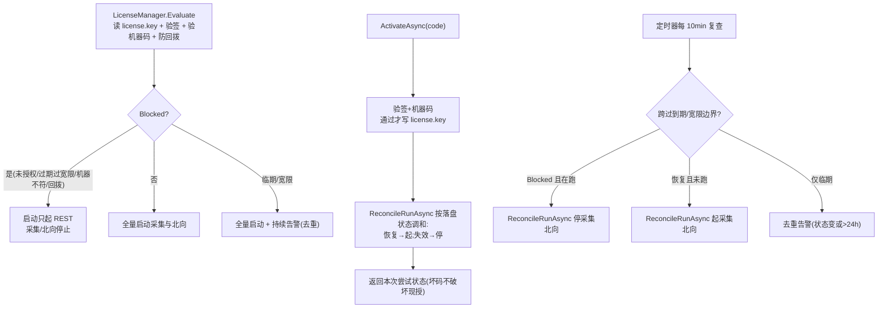

源码：[GatewayHost.cs:339-415](file:///d:/AI/AIProject/IGW/src/IGW.Runtime/GatewayHost.cs)；[LicenseManager.cs](file:///d:/AI/AIProject/IGW/src/IGW.Licensing/LicenseManager.cs)。

---

## 五、数据流程（端到端）

南向采集 → DataHub 缓存 → 北向多通道发布的完整数据通路：

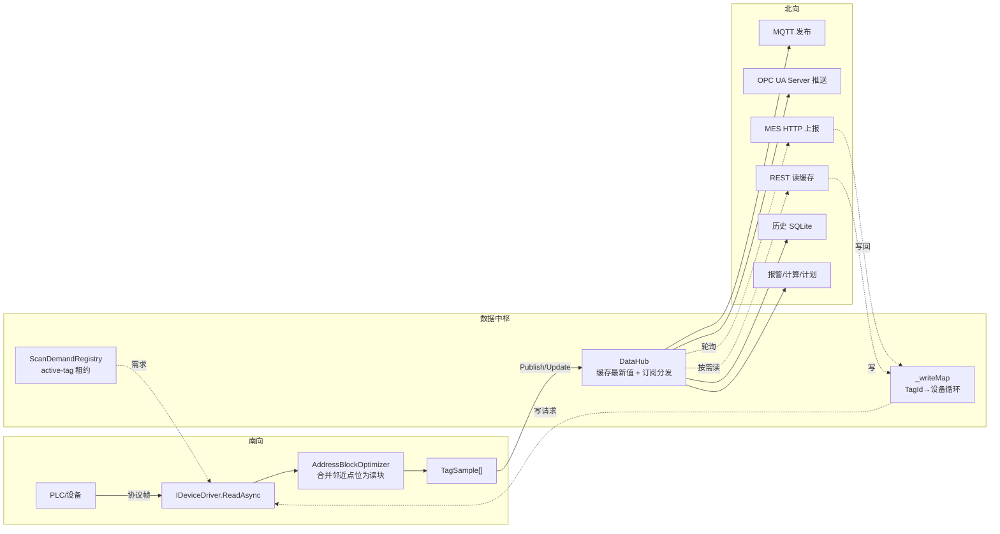

关键不变量：
- **单写者**：每个点位只被其所属设备循环写入，无锁。
- **零穿透**：北向读全走缓存，绝不直接读 PLC。
- **按需采集**：活动点（被 REST 读/OPC UA 监控/MES 租约引用）才纳入扫描计划。
- **共享 Hub**：南向与北向通过同一个 `DataHub` 解耦，热重载北向时不影响设备缓存。

---

## 六、模块交互与依赖

### 6.1 项目依赖方向

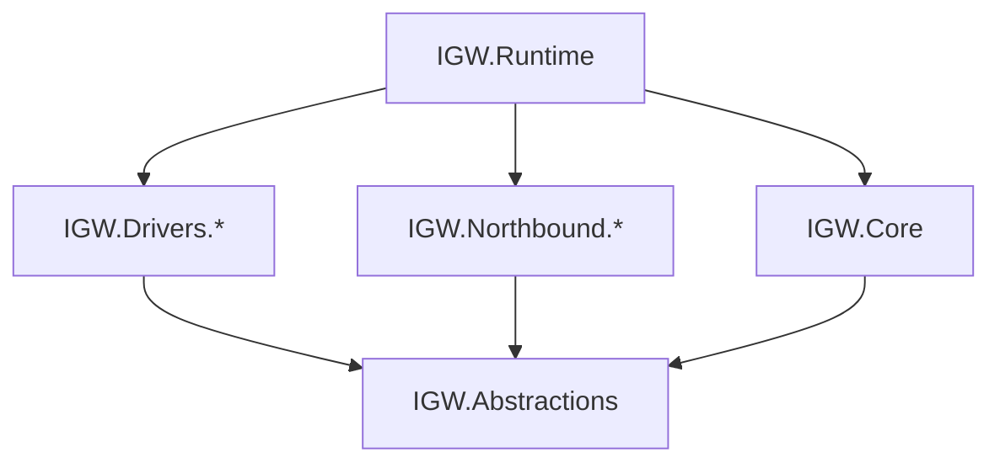

> 运行时（IGW.Runtime）是依赖汇聚点，引用 Core + 全部北向 + 全部驱动；驱动与北向只依赖 Abstractions，互不耦合。

### 6.2 启动时序编排

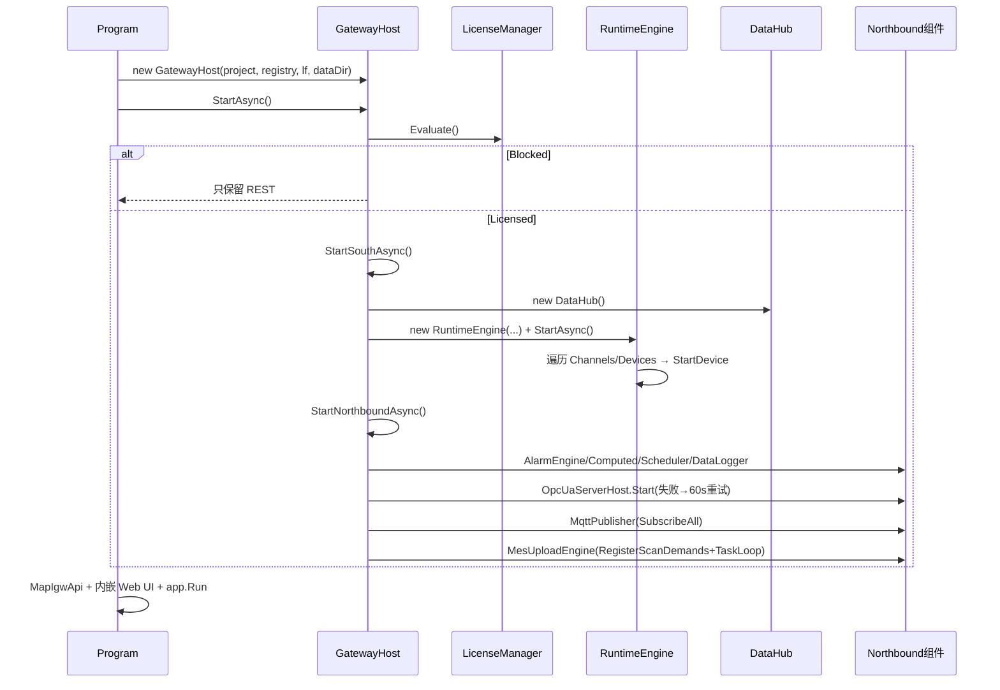

---

## 七、控制流程关键逻辑小结

| 控制点 | 机制 | 位置 |
|--------|------|------|
| 授权闸门 | Evaluate → Blocked 只起 REST；10min 复查调和起停 | GatewayHost.cs |
| 热重载闸门 | `_gate` 信号量 + `Reloading` 标志（数据端点 503） | GatewayHost.cs |
| 南向增量签名 | `ChannelsSig` 哈希比对，南向不变跳过设备重建 | GatewayHost.cs / Engine.cs |
| 设备级 CTS | 每设备链到全局，可单独停 | Engine.cs |
| 熔断器 | Closed→Open(阻塞)→HalfOpen(单探)→Closed | Engine.cs DeviceLoop |
| 退避抖动 | 1~5s ×(0.7~1.3) 抖动，读成功才复位 | Engine.cs |
| 自动降级 | 连续故障达阈值进入降级期，停采集 | Engine.cs |
| 主备冗余 | 备用路径定期探测主，恢复切回 | Engine.cs |
| 通道自动重连 | AutomaticChannelReconnectLoopAsync | Engine.cs |
| active-tag | Touch/Pin/IsActive 决定是否扫描 | DataHub |
| OPC UA 重试 | 启动失败 60s 后台重试直到成功 | GatewayHost.cs |
| 北向停止超时 | 8s 兜底，避免卡住配置保存 | GatewayHost.cs |
| 证书临期巡检 | 24h 巡检，提前 30 天告警 | GatewayHost.cs |
| 连接重试风暴抑制 | 增量起设备分批 100 台 + 间隔 | Engine.cs |

---

## 八、结论

IGW 采用经典的**「南向驱动 → 内存缓存中枢 → 北向多协议发布」三层架构**，以 `DataHub` 为唯一数据交汇点、以 `GatewayHost` 为运行时编排核心。其工程模型（Project→Channel→Device→Tag）与功能集（OPC UA/IoT/Advanced Tags/Data Logger/Scheduler/Security/Alarm）对标 KEPServerEX，但在热重载（南向增量签名）、百万点位（按点订阅+active-tag）、现场可用性（熔断/降级/主备/退避抖动）三方面做了面向工业长跑场景的工程化加固。整体控制流程围绕"采集循环"与"热重载闸门"两条主线展开，授权作为顶层开关贯穿启动、激活、复查、调和四个环节。
