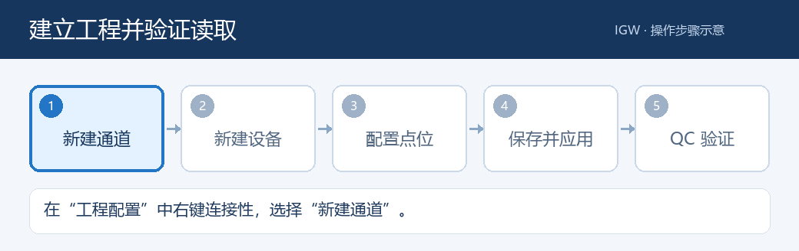
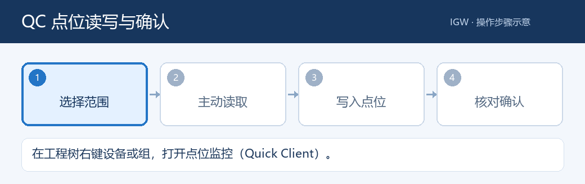

# IGW 现场操作手册

**适用界面：IGW 1.6.97 Web 管理端** · **更新日期：2026-09-28**

**阅读对象：现场操作员、PLC 调试人员、MES 流程配置人员**

这份手册只讲在网页上如何操作。示例名称、地址和值均为说明用途，请使用现场核对过的 PLC 地址、点位表和 MES 接口资料。不同版本的按钮位置可能略有区别；先到「IGW 设置」确认网页显示的网关版本。

## 1. 第一次使用：先走一遍最短路径

1. 用浏览器打开管理员提供的 IGW 地址，例如 `http://网关地址:48020/`。首次打开通常进入「工程配置」。
2. 在「IGW 设置」看「当前运行状态」和「授权与激活」。网页能打开，不等于采集已经启用。
3. 在「工程配置」建立通道、设备、标记组和点位，或按第 4 章导入已有配置。
4. 点击「保存并应用」，等待右上角状态变为「已同步」。
5. 在设备或组上打开 QC，点「从 PLC 读取当前范围」，检查值、质量和时间戳。
6. 需要 MES 时，到实际业务数据组打开「采集流程」，保存后再开启运行。
7. 在「监控中心」「采集性能」「日志中心」确认现场运行情况。

> 动画是操作顺序示意，不是实际界面录屏。按钮以当前网页显示为准。

## 2. 先认识六个页面

| 页面 | 什么时候用 | 常看的内容 |
|---|---|---|
| **工程配置** | 建通道、设备、组、点位；导入导出工程；打开 QC | 左侧工程树、右侧当前层级、保存状态 |
| **采集流程** | 为数据组配置和启停 MES 采集任务 | 任务列表、流程画布、节点配置、运行状态 |
| **监控中心** | 发现设备离线、点位异常、MES 节点失败 | 工位卡片、PLC 连接诊断、点位异常、异常队列 |
| **采集性能** | 排查「PLC 已变化但页面更新慢」 | 配置周期、实际完成间隔、最近批次耗时 |
| **日志中心** | 查某次读写、上报、回写的详细过程 | 时间筛选、事件详情、请求/响应报文、打包导出 |
| **IGW 设置** | 看版本、授权、设备在线数，配置自动保存等 | 当前运行状态、授权、服务与工程设置 |

顶部语言按钮可在中文和英文之间切换；用户自己填写的设备名、组名和点位说明不会自动翻译。

### 怎样判断「正在正常采集」

- 「设备在线」只表示设备连接状态。要确认一个点是否有值，还要在 QC 看该点的**值、质量、时间戳**。
- 「活动标记 0 / 总点数」表示当前没有活动采集点。工程里有点位，不代表每个点都在持续扫描。
- QC 的「实时流」展示网关**已经采集到**的值。想立即知道 PLC 当前值，点「从 PLC 读取当前范围」，或设置合理的定时刷新。
- 「质量异常」的值不应用作正确的生产结果；先查「监控中心 → 点位异常」。

## 3. 工程配置：新建、修改、保存

左侧是工程树，通常按「项目 → 连接性 → 通道 → 设备 → 标记组 → 点位」组织。**左键选中、右键找操作、双击打开属性**。右侧表格显示当前层级的内容；工具栏图标悬停可查看名称。

如果要从空白工程开始，先导出当前工程，再点顶部「新建工程」并确认清空当前编辑内容。大工程模式下，页面可能提示通过「导入 JSON 配置」整体替换，此时按第 4.2 节操作。

### 3.1 新建通道和设备

1. 在「工程配置」左侧右键「项目」或「连接性」，选「新建通道…」。
2. 在向导中选择协议，填写唯一的通道名称。使用以太网协议时，选择能连到 PLC 网段的本机网络适配器。
3. 按向导填写端点、连接和超时等参数，最后在汇总页核对并点「完成」。
4. 右键刚建好的通道，选「新建设备…」。填写设备名称、PLC IP/端点、型号和该协议要求的参数，点「加入」。
5. 点击「保存并应用」。在工程树或通道右键「诊断」查看连接状态；需要重新建立连接时用「立即重连」。

常用协议在向导里的入口如下：

| 现场设备 | 通道类型 | 配置时重点核对 |
|---|---|---|
| Siemens S7 / S7 Plus | `Siemens TCP/IP Ethernet` | PLC 型号、IP、机架/槽位、权限与连接参数 |
| 远端 OPC UA 服务器 | `OPC UA Client` | 通道的服务器端点 URL、安全策略、登录方式；设备用于组织地址结构 |
| Modbus TCP | `Modbus TCP/IP Ethernet` | IP/端口、Unit ID、寄存器地址规则 |
| Omron / Mitsubishi / EtherNet/IP / MQTT | 对应协议类型 | 使用现场设备提供的协议参数，不套用其他协议示例 |

> 如果列表显示某个旧驱动「不支持」，不要继续用它新增设备。先确认现场应使用的协议类型。

### 3.2 建组和点位

1. 右键设备选「新建标记组」，填写名称和说明；按业务 DB 或工位分组，便于 QC 和 MES 选择范围。
2. 右键设备或组，选「新建标记」。在属性编辑器中填写**名称、PLC 地址、数据类型、客户端访问、扫描速率**。不同协议可用的地址编辑项不同，以页面的「地址格式速查」为准。
3. 需要写 PLC 的点位，检查「客户端访问」是否为「读/写」或「只写」。只读点不会因为在 QC 输入值就变成可写。
4. 字符串点可选择文本编码；数组点使用「数组配置」。缩放和报警属于可选配置，普通点位可以先不填。
5. 点「确定」，再用 QC 对照 PLC 当前值验证地址、类型与质量。

点位很多时，先定位设备或组，再使用右侧表格、搜索和分页；不必一次展开整棵工程树。不要通过复制旧点位来猜地址，尤其是数组下标和结构成员。

### 3.3 修改、移动和删除

- 双击通道、设备、组或点位可打开属性；组可拖到设备或另一个组下，剪切/复制/粘贴也可用 `Ctrl+X/C/V`。
- 删除前确认当前选中项。删除设备或组时，**其下级内容也会一起删除**；关联的采集流程可能被同步移除。
- 工具栏的「撤销」目前不可用。做大范围修改前先按第 4.1 节导出工程。
- 属性对话框点「确定」会立即保存；剪切、粘贴、拖动等其他修改可由后台自动保存，或点击「保存并应用」。不要在显示「保存中…」时反复点击。

### 3.4 看懂保存状态

| 页面提示 | 应怎样做 |
|---|---|
| 「已同步」 | 当前页面改动已保存；正式投用前仍建议核对设备和点位 |
| 「待后台保存」 | 等待状态更新，或点击「保存并应用」立即保存 |
| 「有未保存的修改（自动保存已关闭）」 | 点击「保存并应用」后再离开页面 |
| 「自动保存失败/冲突」 | 先看错误提示，不要连续重试或刷新；核对是否有其他人同时改工程，再处理冲突 |

自动保存开关和间隔在「IGW 设置 → 工程配置自动保存」中调整。**重新载入工程数据**会读取已保存的工程；如果当前有未保存修改，先保存或确认要放弃。

## 4. 导入、导出和备份

### 4.1 导出整个工程 JSON

在「工程配置」顶部点「导出 JSON 配置」，在弹窗里点「导出 JSON」，等待浏览器下载完成。普通备份保持「包含可迁移的连接密钥」不勾选；确需迁移受保护的连接信息时，按现场管理要求勾选并设置迁移密码，妥善保管密码。做批量改点位、改通道或导入之前，先留一份能找到日期和现场名称的备份。导出文件应按现场资料管理，不要随意转发。

### 4.2 导入整个工程 JSON

1. 先导出当前工程作为备份。
2. 点顶部「导入 JSON 配置」，选择工程 JSON 文件。
3. 等待「正在检查文件」结束，核对预览里的**通道、设备、组、点位、MES 任务数量**和兼容性提示。
4. 如果文件含可迁移的受保护信息，按页面要求输入迁移密码。
5. 确认目标是当前网关后，点「替换当前工程」。等待「正在导入并应用工程」完成。
6. 回到工程树，抽查关键设备、点位和 MES 任务，再在 QC 验证真实读取。

「替换当前工程」是整体替换，不是把文件里的点位追加到现有工程。预览数量或设备名不对时，点「取消」重新选择文件。

### 4.3 只导入部分点位

- **CSV**：选中目标设备或组，右键「导入 CSV…」；完成后检查点位名称、地址、类型，再保存并用 QC 抽查。右键「导出 CSV」可导出当前范围的点位表。
- **Siemens DB 文件**：在 Siemens 设备或组上，右键「从 PLC 文件导入(西门子 DB)…」，选择现场提供的 DB/SCL/UDT 等文件；完成后核对数组、结构成员和 PLC 地址。
- **OPC UA 浏览生成**：配置好 OPC UA Client 通道的服务器端点后，在设备上右键「自动生成标记…」，浏览远端节点并选择需要的范围；保存后用 QC 验证。

## 5. QC：读取、写入和数组调试

在「工程配置」中，右键设备或标记组选择「在此处打开点位监控(Quick Client)」，或选中范围后点工具栏 **QC**。QC 窗口可以与采集流程窗口同时打开，也可以最小化后从底部工作栏恢复。

### 5.1 主动读取当前 PLC 值

1. 在 QC 左侧选择设备或组。右侧会分页显示当前范围的点位，可按点名、地址或说明搜索。
2. 点工具栏刷新图标「从 PLC 读取当前范围」。等待「正在从 PLC 读取…」消失。
3. 查看目标行的**值、质量、时间戳**。若有「最近批次耗时」，它是同一批请求的共享耗时，不是该点单独读取所花的时间。
4. 需要连续观察时，在「定时刷新」输入毫秒数；填 `0` 为关闭，最小可设 `50 ms`。周期从上一次读取结束后开始计时。只调试少量点时可用短周期，范围大时应适当加长。

「实时流」连接正常但表格没有新值时，先做一次主动读取；它不会自行替未采集点启动 PLC 轮询。读失败时查看底部「事件日志」，再到「监控中心 → 点位异常」核对原因。

### 5.2 写入一个点位

1. 先确认目标设备、点位完整路径、数据类型和当前值。对布尔值按输入框提示使用 `true` / `false`。
2. 选中可写点，点写入图标，或右键点位选「同步写入…」。
3. 在弹窗输入目标值，点「写入」；等待窗口给出结果，不要在等待时重复提交。
4. 以「**写入并回读确认成功**」作为 PLC 实际值已核对的结果。如果只提示「协议已接受写入，未回读验证 PLC 实际值」，还需主动读取并与 PLC 侧核对。
5. 失败时记录弹窗错误、点位路径、请求值和时间，到「日志中心」查询同一时段事件。

> 写入会影响 PLC 控制状态。生产现场只写已获准调试的点位和值；不要把「设备在线」当成写入成功证明。

### 5.3 数组点位

数组点在右侧下方的切片区读取和查看元素。先选数组点，再指定需要查看的切片/下标；写入时选择具体元素或当前切片。不要为验证单个元素而一次请求整个大数组。

## 6. MES 采集流程：从建任务到开启运行

MES 流程应挂在**实际业务数据组或 PLC 数据块**上。若在设备顶层看不到入口，先进入包含业务点位的组。也可通过顶部「采集流程」查看任务列表；从工程树右键进入会直接定位当前组。新建流程默认不运行，配置完成后再开启。

### 6.1 用模板建立一条标准流程

1. 在目标组右键选「MES 采集流程(当前数据块)…」。左侧确认任务绑定的组路径。
2. 点击「流程模板」，按业务选择「标准握手上报(条件→上报→判成败→回写)」「定时上报(无握手)」等模板；也可选择「从空白自定义流程」。
3. 点击画布节点，在右侧配置栏填该节点参数；拖动节点端口建立连线。「自动排布」可整理画布。
4. 点「校验」，修正缺入口、缺执行动作、点位路径或连线等提示。
5. 点「保存并应用」，确认没有保存失败/冲突后，再打开「开启运行」开关。
6. 勾选「运行状态」或打开「时间线」观察一轮：条件是否命中、上报是否完成、判定走哪条分支、回写是否成功。

| 节点 | 需要填写什么 | 现场核对点 |
|---|---|---|
| **采集周期** | 周期毫秒数；可选上报点位采集方式 | 周期按任务配置；需要 PLC 条件时使用独立「条件」节点 |
| **条件** | 判定点、比较符、目标值与分支 | 多个条件是否全满足、默认出口是否接好；质量异常不能当作条件成立 |
| **上报** | 上报地址、等待超时、「配置数据」及字段/结构映射 | 预览报文中的字段、结构下标、设备/DB 来源是否正确 |
| **判成败** | 成功字段或期望值、成功/失败出口 | HTTP 成功与业务成功分别核对，后续节点按对应出口执行 |
| **回写** | 目标 PLC 点位、响应字段或固定值、写后确认 | 目标点必须可写，成功/失败分支不要接反 |

### 6.2 采集周期与分层采集

在「采集周期」节点填写任务需要的周期，页面允许 `50–3,600,000 ms`。周期是任务的计划节拍，现场实际完成间隔还受 PLC 读取、HTTP 上报和回写耗时影响；用「采集性能」看真实间隔。不要只凭配置数字判断已达到该速度。

「上报点位采集」可选**跟随全局、分层、常驻**：分层方式在条件满足后按需读取上报点位；常驻方式持续采集这些点。点位较多时，先按业务需要选模式，再观察 PLC 负载和实际完成间隔。

### 6.3 上报、业务结果与回写

- 在上报节点点「配置数据」，选取本组或其他设备/DB 的点位，检查字段名、结构成员和是否上报。不要只看点位数，要核对最终报文预览。
- 上报节点会把响应留给后续节点。需要按 `OK/NG` 分流时，在它后面接「判成败」；不要只看 HTTP 200 就认定业务成功。
- 回写节点可把响应字段写到 PLC，也可写固定值或从其他 PLC 点位复制值。字段路径可按页面示例填写，例如 `backResult.errorCode`。
- 勾选「写后确认」时，IGW 会回读 PLC 核对实际值；回读不一致时的最多重写次数可在节点上设置，默认显示为 `10`。次数用尽仍不一致会记为失败。关闭确认只表示协议接受写请求，不能证明 PLC 值已一致。
- 修改点位路径、报文格式或回写目标后，先保存，再用一轮现场数据检查时间线与日志。

### 6.4 暂停和排查流程

需要停用任务时，关闭当前任务的「开启运行」开关，并确认状态从「运行中」变为「尚未启用」。异常时在「监控中心」点「定位画布」，查看标红节点和原因；再到「日志中心」按任务或时间查接口请求/响应。画布的「操作历史」只保留本次打开期间的最近几次操作，不能替代工程备份。

## 7. 监控中心：先定位范围，再看原因

1. 先看顶部「工位状态」。点击异常工位卡片可筛选相关内容，再点「清空筛选」回到全局。
2. 设备连不上时看「PLC 连接诊断」。展开一行，依次看**判断原因、处理建议、原始错误、首次/最近发生时间**，再核对现场网卡、PLC IP、端口、型号和权限。
3. 设备在线但少数点没有值时看「点位异常」。展开对应点，核对**点位路径、PLC 地址、质量码、原因和建议**。不要因为一个点 Bad 就直接判整台设备离线。
4. 如果逻辑数组只有部分元素异常，查看「逻辑数组质量与容量」里的失败范围；按 PLC 实际下标确认。
5. MES 报错或卡住时看下方异常队列。点「定位画布」打开对应任务和节点，结合「运行状态」与「时间线」核对。

「当前异常」显示仍在发生的记录；「已恢复」便于回看本次运行期间自动恢复的情况。内部数据通道正常只表示网关内部队列正常，不能替代 PLC 在线和点位质量检查。

## 8. 采集性能：判断到底慢在哪里

打开顶部「采集性能」，选择设备。这个页面展示已有诊断数据，**不会因为打开页面额外读取 PLC**。

- 先比较「配置周期」与「平均完成间隔」「P95 完成间隔」；实际间隔显著变长，说明现场完成一轮所需时间超过配置预期。
- 再看「最近一批耗时」「最近实际请求」「超期」及点位数。展开最近批次，找耗时最长的步骤和点位范围。
- 订阅/被动采集模式下，部分主动轮询指标会显示「—」或「不适用」，不要把它当成零耗时。
- 点「导出诊断包」可保存当前诊断证据，便于与 PLC 程序更新时间、网络事件和日志对照。

如果 QC 很快而 MES 仍慢，分开比较 PLC 读取、接口等待和回写时间；如果多个设备一起变慢，先看连接与实际请求数，不要直接把所有延迟归因于单个点位。

## 9. 日志中心：查清一次操作发生了什么

1. 选择时间范围，输入设备、点位、任务或关键词，点「查询日志」。结果多时缩小时间范围，再使用「高级筛选」选模块/功能。
2. 点击事件查看详情；上报或接口事件可按需加载请求/响应报文。核对时间、HTTP 状态、业务返回和错误说明。
3. 排查完点击「打包导出」，可选当前筛选、最近 1 小时、今天或最近 24 小时，并按需勾选「附带接口请求/响应报文」。下载的 ZIP 中有可直接阅读的 `logs.txt`。
4. 只有在明确需要调整保留期或路径时才进入「日志设置」。更换日志位置会迁移并校验日志与报文；等待页面显示迁移结果。

「一键清理」用于清理旧版本遗留日志。启动前逐项核对勾选列表；它不会删除当前工程和授权，但不应作为日常排障的第一步。

## 10. IGW 设置：日常要看的四件事

| 位置 | 日常操作 |
|---|---|
| **当前运行状态** | 核对网关版本、运行状态、在线设备、活动标记和网页连接 |
| **授权与激活** | 查看授权是否有效；需要激活时复制机器码，取得授权码后粘贴并点「激活授权」 |
| **工程配置自动保存** | 按现场管理要求开启/关闭；间隔可设为 5–3600 秒。关闭后，剪切、粘贴、拖动等改动须手动「保存并应用」 |
| **服务端口 / OPC UA 服务器** | 仅在有变更计划时修改。REST 端口更改后需重启网关并用新地址访问；OPC UA 服务设置会使客户端短暂重连 |

设置页有修改时点「保存并应用」。若出现保存冲突，先确认是否有人同时修改设置，不要盲目重新载入而丢掉本页尚未保存的内容。

## 11. 常见情况：按现象找下一步

| 现象 | 先做什么 |
|---|---|
| 网页打不开 | 核对网址/端口；联系维护人员确认网关服务状态 |
| 网页打开但设备离线 | 到「监控中心 → PLC 连接诊断」展开原因，再核对网卡、IP、端口、PLC 型号和权限 |
| 设备在线但 QC 没有值 | 选正确设备/组，点「从 PLC 读取当前范围」；再看质量、时间戳和「点位异常」 |
| PLC 已变化，网页晚几秒才更新 | 先区分「实时流」与主动读取；到「采集性能」看实际完成间隔和最近批次，再对照日志时间 |
| 写入长时间等待或失败 | 等本次结果返回，检查是否启用了回读确认；核对点位可写、目标值、质量和事件日志，不要连续重复点击 |
| MES 流程没有上报 | 确认任务「开启运行」、条件出口有连线、上报地址和数据范围正确；看画布时间线与日志中心 |
| HTTP 返回成功但业务不通过 | 到「判成败」检查响应字段和期望值，查看实际响应报文；不要只看 HTTP 状态 |
| 保存失败或提示冲突 | 先保留当前错误文字，检查是否多人改同一工程；导出可用的备份后再重试或重新载入 |
| 导入预览数量不对 | 取消导入，检查文件来源、工程版本和目标网关；不要点「替换当前工程」 |

## 12. 交接和日常检查

每次修改后，至少记录：**网关地址与版本、修改的通道/设备/组/点位、修改时间、工程备份文件、QC 读取结果、是否做过 PLC 写入、MES 任务启停状态**。遇到故障时再附上「采集性能」诊断包和同一时间段的日志 ZIP。

日常检查顺序建议固定为：**运行状态 → 设备在线 → 关键点质量和值 → MES 任务与时间线 → 当前异常 → 日志**。只要其中一步显示异常，就先定位原因，不要仅凭网页显示绿色就认定业务闭环成功。
