# IGW 用户操作手册

> 本文是 1.5.94 旧版资料。当前界面的日常操作请看 [IGW 1.6.97 现场操作手册](IGW现场操作手册_v1.6.97.md)。

**适用版本：1.5.94（旧版）**
**适用对象：现场调试工程师、PLC 工程师、MES/IT 对接人员、设备维护人员**  
**文档日期：2026-08-25**

> 本手册以当前 Web 管理端为准。默认访问地址为 `http://localhost:48020/`。示例中的设备名、IP、端口和业务字段仅用于说明；正式上线前请按现场网络、PLC 程序和 MES 接口文档核对。

---

## 1. 产品定位与快速导航

IGW 是面向工业现场的 PLC 数据采集与 MES 对接网关。它把不同协议的通道、设备、DB/数据组和点位统一放进一棵工程树中，通过运行时采集、QC 调试、MES 流程画布、监控中心和 REST 接口完成“读 PLC—组装业务数据—调用接口—回写 PLC”的闭环。

### 1.1 核心功能

| 功能 | 用途 | 主要入口 |
|---|---|---|
| 工程配置 | 创建通道、设备、DB/组、标记；导入/导出配置 | 顶部“工程配置” |
| QC 点位监控 | 在线查看质量、值、时间戳；人工写值调试 | 工程树右键“在此处打开点位监控（Quick Client）” |
| MES 采集流程 | 配置采集周期、条件、上报、判定和回写 | 真实 DB/数据组右键“MES 采集流程” |
| 监控中心 | 查看设备离线、节点失败、卡住和慢于基线 | 顶部“监控中心” |
| IGW 设置 | 运行参数、网卡、授权与语言设置 | 顶部“IGW 设置” |
| PLC 操作 API | 供第三方按 Tag 读取、写入和注册点位 | `/swagger/index.html` |

### 1.2 首次使用最短路径

1. 安装 IGW 并打开 `http://localhost:48020/`。
2. 在“工程配置”中新建通道，选择协议和本机网卡。
3. 在通道下新建设备，填写 PLC 地址与协议参数。
4. 导入 DB、CSV、JSON 配置，或手工创建数据组和标记。
5. 点击“保存并应用”，等待设备显示在线。
6. 通过 QC 验证读取和写入。
7. 在具体 DB/数据组上创建 MES 采集流程。
8. 在监控中心观察运行状态和异常原因。

### 1.3 状态判读原则

- “网络可达”只代表 TCP/IP 路由可能正常，不代表 PLC 协议、机架槽位、DB 地址、安全策略或证书正确。
- 设备在线与是否配置 MES 流程无关。只要工程中有启用的点位或 QC 主动请求，运行时就可以建立连接。
- 一个 DB 读失败不应阻塞同一设备下其他可用 DB；质量为 Good 的点仍可使用，Bad 点按质量策略处理。
- 工程树中的“在线/离线/部分异常”来自运行时状态；监控中心用于展示更细的根因与时间线。

---

## 2. 安装、启动与授权

### 2.1 安装前准备

- Windows 10/11 或 Windows Server 2019 及以上版本。
- 安装账户具有管理员权限，以便安装 Windows 服务和防火墙规则。
- 现场网络已规划 PLC 网段，本机对应网卡已配置 IPv4 地址。
- 西门子 Classic S7 默认使用 TCP 102；OPC UA、Modbus、FINS、EtherNet/IP 等端口以设备配置为准。

### 2.2 安装步骤

1. 双击 `IGW-Setup-1.5.94.exe`。
2. 按向导完成安装。默认程序目录为 `C:\Program Files\IGW`。
3. 安装器创建并启动 Windows 服务“IGW Gateway”。
4. 浏览器打开 `http://localhost:48020/`。
5. 若页面未打开，在“服务”中确认 IGW Gateway 为“正在运行”，再查看 `%ProgramData%\IGW\logs`。

> 用户工程、数据库、日志、授权和 OPC UA PKI 不保存在 Program Files，而保存在 `C:\ProgramData\IGW`。升级时不要删除该目录。

### 2.3 试用与授权

首次安装可进入 7 天试用期。普通卸载后重新安装不会重新获得试用期。试用结束后，需要在“IGW 设置—授权与激活”中复制本机机器码，由授权工具生成授权码后粘贴激活。

授权操作：

1. 打开“IGW 设置”。
2. 找到“授权与激活”。
3. 点击“复制”取得本机机器码。
4. 将机器码交给授权管理员生成授权码。
5. 粘贴授权码并点击“激活授权”。
6. 确认状态显示“授权有效”和到期日期。

安全注意：私钥只应保存在授权管理员的离线工具中，不要复制到 IGW 运行服务器或提交到 Git。

### 2.4 启停与升级

- 日常运行由 Windows 服务托管，不需要保持命令行窗口。
- 升级前先导出 JSON 配置，并备份 `C:\ProgramData\IGW`。
- 使用新版安装包原地覆盖安装；安装器保留工程、设置和授权。
- 升级后核对页面版本、工程树、设备在线状态、QC 和一个典型 MES 流程。

---

## 3. Web 管理端与通用操作

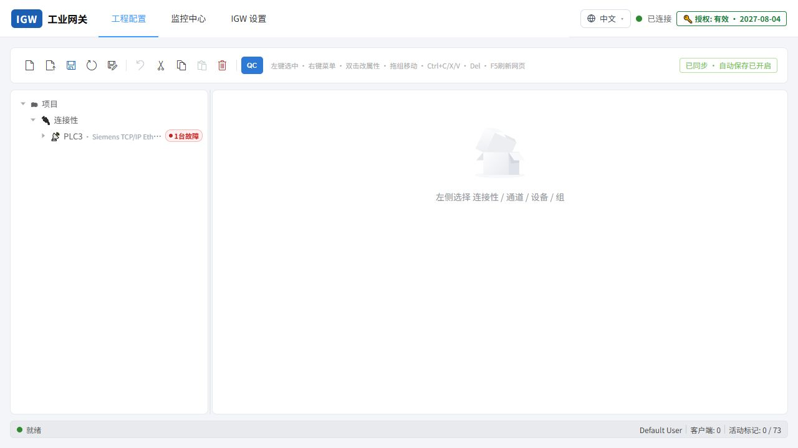

**图 1　工程配置总览。**

| 区域 | 说明 |
|---|---|
| 顶部导航 | 在工程配置、监控中心和 IGW 设置之间切换；右侧显示连接与授权状态。 |
| 工具栏 | 新建、导入/导出 JSON 配置、保存并应用、重新加载工程、剪切复制粘贴、删除和 QC。 |
| 左侧工程树 | 按“项目—连接性—通道—设备—DB/组—标记”显示真实层级。 |
| 右侧内容区 | 显示当前节点的子项、点位参数、地址、扫描周期和说明。 |

### 3.1 页面入口

- **工程配置**：工程建模和调试主页面。
- **监控中心**：生产运行时的异常和工位状态页面。
- **IGW 设置**：网关设置、运行参数、授权和语言。

### 3.2 保存机制

- 工程配置每 30 秒后台静默保存一次，不阻塞鼠标和键盘操作。
- 删除等破坏性操作会尽快持久化，避免刷新后恢复。
- “保存并应用”立即保存并把配置热加载到运行时；用于正式下发前的明确确认。
- 关闭 MES 流程窗口时，如果配置有效，系统会尝试保存；若引用的目录已经消失，则删除失效流程；若 DB 结构改变，则尽量保留画布并清理已失效的上报数据范围。
- `Ctrl+S` 可在采集流程中执行保存。

### 3.3 快捷键

| 快捷键 | 作用 |
|---|---|
| `Ctrl+C / Ctrl+X / Ctrl+V` | 复制、剪切、粘贴工程节点或画布元素 |
| `Delete` | 删除当前选择 |
| `Ctrl+S` | 保存当前采集流程 |
| `F5` | 刷新 Web 页面 |
| `Ctrl` + 单击 | 画布多选 |

### 3.4 中英文切换

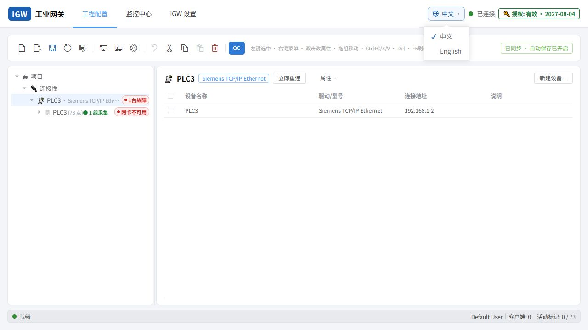

**图 2　语言切换入口。** 语言切换后立即生效，并保存到数据库。即使强制刷新或重新打开浏览器，也继续使用上次语言。系统菜单、项目/连接性节点、状态、向导、对话框和 MES 流程标题会随语言切换；用户自定义的通道名、设备名、DB 名、字段名和注释不自动翻译。

---

## 4. 工程结构与节点边界

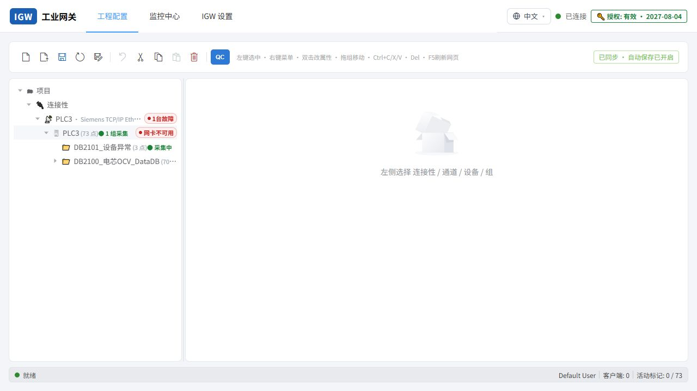

**图 3　工程树真实层级。**

### 4.1 层级定义

| 层级 | 含义 | 可以进行的主要操作 |
|---|---|---|
| 项目 | 当前 IGW 工程根 | 整体导入/导出、保存与应用 |
| 连接性 | 所有南向连接容器 | 创建通道 |
| 通道 | 一种协议连接及共用参数 | 新建设备、选择网卡、立即重连、诊断 |
| 设备 | 一个真实 PLC 或逻辑设备 | PLC 地址、型号、机架槽位、认证；创建组 |
| DB/数据组 | 一个真实 PLC DB、结构体根或 OPC UA 顶层业务目录 | 导入点位、配置 MES 流程、打开 QC |
| 标记 | 可读写变量 | 地址、类型、扫描周期、数组和结构信息 |

### 4.2 MES 流程的正确挂载位置

MES 流程必须绑定到实际业务数据边界：西门子一般是具体 DB，OPC UA 一般是设备下一级顶层业务目录。设备顶层、通道顶层或同时包含多个 DB 的宽泛容器不显示 MES 流程入口。这保证同一设备下多个 DB 可以分别配置、独立运行和独立诊断。

### 4.3 大工程操作建议

- 一百万点不要在工程树中展开成一百万个可见节点；优先使用逻辑数组、结构体数组和分页/切片查看。
- 50 个工位可按通道、设备和业务 DB 分层，工位之间的 MES 任务并行运行。
- 不要为“急速/普通”手工分通道；运行时按用户配置的随机扫描周期调度，并合并可合并的读取。
- 仅内存采集且不保存历史数据时，关闭不需要的数据记录功能。

---

## 5. 创建通道与配置设备

### 5.1 新建通道

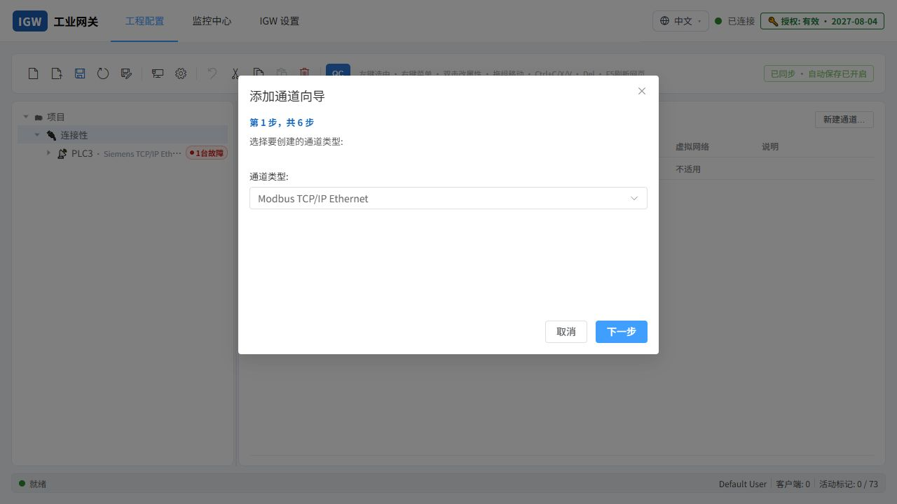

**图 4　新建通道向导。**

1. 在“连接性”上右键，选择“新建通道”。
2. 输入唯一的通道名称。
3. 选择驱动协议。
4. 选择网络适配器；通常选择“网卡名称 — IPv4”。
5. 按向导填写该协议的通信参数。
6. 完成后在通道下新建设备。
7. 点击“保存并应用”。

### 5.2 支持的通道类型

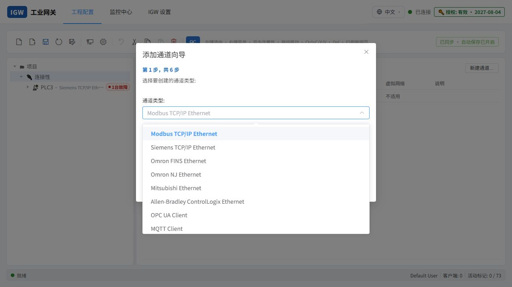

**图 5　当前 Web 向导中的协议。**

| 协议 | 常见设备/用途 | 地址要点 |
|---|---|---|
| Modbus TCP/IP Ethernet | 仪表、变频器、PLC | IP、端口、Unit Id、零基地址、字节序 |
| Siemens TCP/IP Ethernet | S7-200/300/400/1200/1500 | IP:102、型号、Rack/Slot；1200/1500 可自动兼容 Classic/Plus |
| Omron FINS Ethernet | CJ/CS/CP 系列 | FINS 节点号、D/CIO/W/H/A/R 地址区 |
| Omron NJ Ethernet | NJ/NX 系列 | 符号变量名、数组和结构体 |
| Mitsubishi Ethernet | 三菱 PLC | D/M/X/Y 等设备地址及驱动参数 |
| Allen-Bradley ControlLogix Ethernet | ControlLogix/CompactLogix | 控制器/程序 Tag、CPU Path（常见 `1,0`） |
| OPC UA Client | 第三方 UA Server、模拟器、KEPServerEX | 端点属于通道，设备只组织导入结构 |
| MQTT Client | 订阅上游消息 | Broker、主题、QoS、JSON 映射 |
| Simulator | 本机调试 | 不连接真实 PLC，仅用于功能验证 |

### 5.3 选择本机网卡

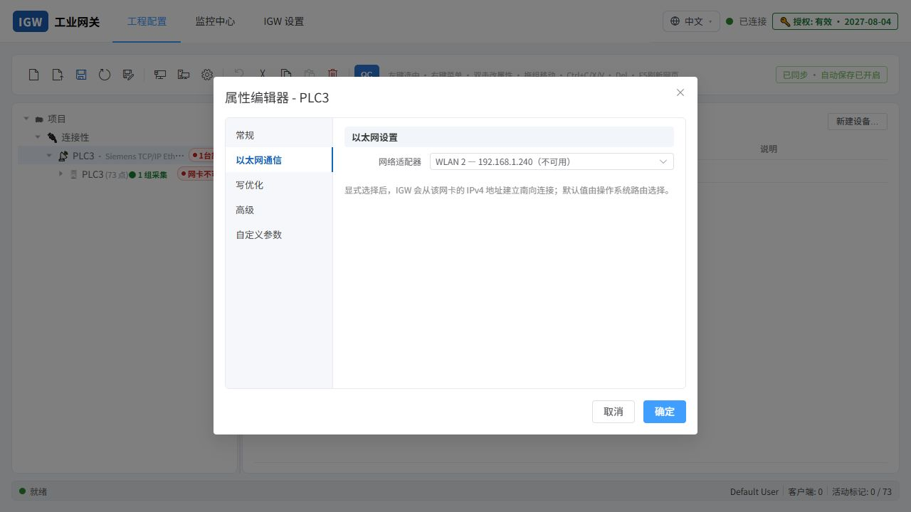

**图 6　网卡选择。** 下拉框显示已启用且具有 IPv4 地址的网卡，格式为“网卡名称 — IPv4”。旧工程中的网卡当前不可用时保留该选项并标记“不可用”，不会静默改成另一张网卡。

多网卡服务器配置原则：

1. 先用 `ipconfig` 确认哪张网卡接入 PLC 网段。
2. 在通道属性中显式选择该网卡，不依赖默认路由。
3. 确认本机 IP 与 PLC 同网段，子网掩码正确。
4. 使用 `Test-NetConnection PLC_IP -Port 端口` 验证目标端口，而不仅是 `ping`。
5. 更换网卡或修改 IP 后，执行通道级“立即重连”。

### 5.4 通道属性与立即重连

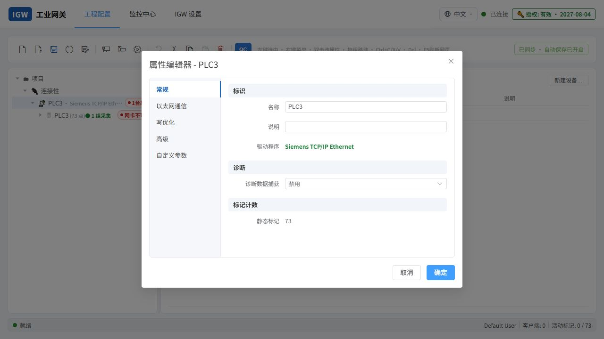

**图 7　通道属性。** 端点、网卡、超时、重连和协议共用参数配置在通道层。

通道右键菜单提供：

- **立即重连**：停止当前通道的会话、清理旧 Socket/协议客户端，从网络层重新创建当前通道连接；不会把已连通的其他通道一并断开。
- **诊断**：读取与工程树相同的实时连接状态，并显示网络、协议、认证、DB/地址等分类原因。

自动断线重连同样采用通道级硬重连。失败后按退避策略继续尝试；手动重连优先执行，不必删除并重建设备。

### 5.5 设备属性

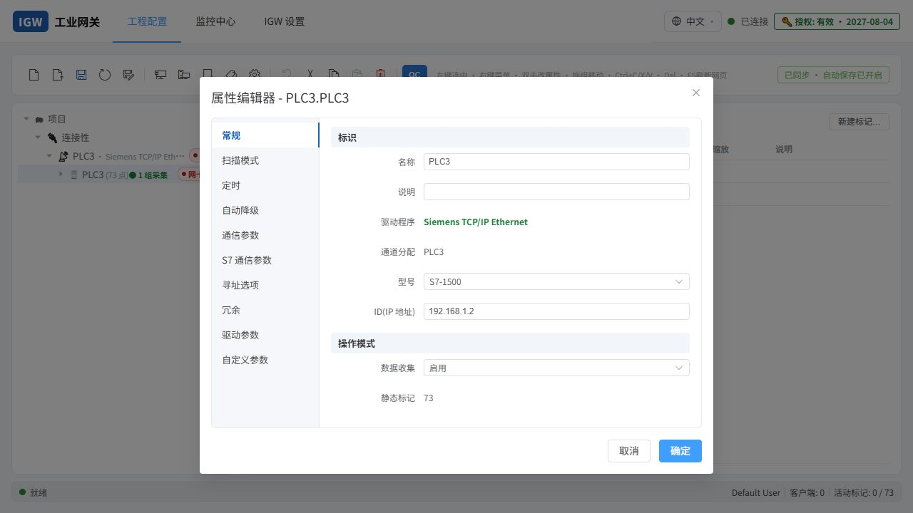

**图 8　西门子设备属性示例。**

关键字段：

- 名称：工程树中的设备名，必须在通道内唯一。
- 型号：S7-200/300/400/1200/1500；应与 PLC 或导入 DB 的能力匹配。
- ID（IP 地址）：支持 `IP:端口`，例如 `192.168.1.2:102`。
- Rack/Slot：S7-300/400 常需准确设置；S7-1200/1500通常为 Rack 0、Slot 1。
- 数据收集：启用后按扫描周期采集；即使没有 MES 任务，QC 主动读取也可使用。

S7-1200/1500 会根据配置和地址自动在 Classic S7 与 S7 Plus 能力间处理。S7 Plus 优先匿名；服务器拒绝匿名时，界面提示配置用户名和密码。凭据经在线验证后使用 Windows 本地保护保存，不随 JSON 工程导出到其他电脑。

---

## 6. 导入、导出与数据结构

### 6.1 JSON 配置

工具栏中的“导入 JSON 配置”和“导出 JSON 配置”用于整体迁移。格式以 KEPServer 兼容的通道/设备/标记结构为外层，并通过 `igw` 扩展保存 IGW 驱动设置、数组定义、结构体布局和 MES 任务。

导出步骤：

1. 点击“保存并应用”，确保当前工程有效。
2. 点击“导出 JSON 配置”。
3. 将文件存入版本化备份目录。
4. 在另一台机器导入前先备份目标机现有工程。

导入步骤：

1. 点击“导入 JSON 配置”。
2. 选择文件并查看通道、设备、标记数量预览。
3. 确认后替换当前工程。
4. 检查网卡绑定、凭据和本机相关路径。
5. 保存并应用，再用 QC 验证。

> JSON 工程应保留原协议标识。导入后若协议、驱动或端口发生变化，应停止使用并通过备份比对；不要直接在生产 PLC 上继续测试。

### 6.2 CSV 导入/导出

在设备或数据组上右键可导入 CSV。系统先检查路径冲突、数据类型和可导入数量，再提示覆盖或跳过。CSV 适合平面点表；复杂数组和结构体优先使用西门子 DB 或 OPC UA 浏览导入。

### 6.3 西门子 DB 源文件导入

1. 在西门子设备或目标组上右键。
2. 选择“从 PLC 文件导入（西门子 DB）”。
3. 选择 `.db` 源文件。
4. 预览 DB 号、点位数、结构体和数组。
5. 确认生成新的 DB 标记组。
6. 保存并应用。

导入器支持优化/非优化 DB 的结构描述、嵌套 STRUCT、结构体数组、多维数组和中文注释。Classic S7 的绝对地址仍要求 PLC 允许相应访问；优化 DB 通常使用 S7 Plus 符号访问。

### 6.4 OPC UA 浏览与自动生成标记

OPC UA 端点配置在通道层。设备右键“自动生成标记”后浏览服务器地址空间，选择需要导入的业务节点。服务器根节点或设备名只用于组织，不应创建 MES 采集流程；真正的业务顶层目录作为 DB/数据组导入。

导入时可自定义目标根组名。IGW 保存稳定 NodeId 作为协议地址，移动 IGW 工程树中的文件夹只改变显示路径，不应改变 NodeId。结构体、数组或 `CellData_0` 等层级会按树结构保存，而不是全部压平到一层。

### 6.5 标记表

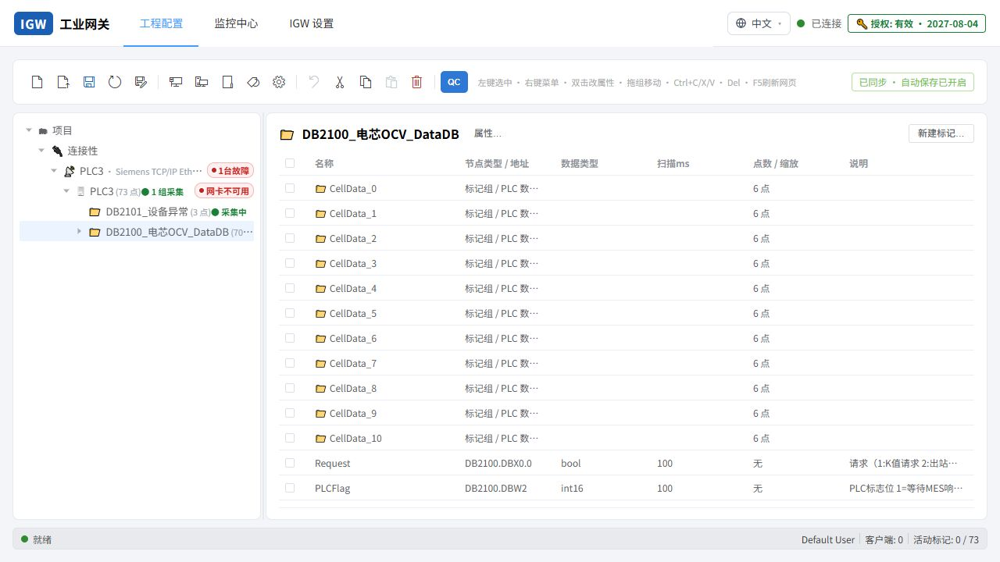

**图 9　标记表。**

| 字段 | 说明 |
|---|---|
| 名称 | 工程内显示名，可用于完整 Tag ID 的最后一段 |
| 节点类型/地址 | PLC 绝对地址、符号名或 OPC UA NodeId |
| 数据类型 | Bool、整数、浮点、字符串、数组、结构体等 |
| 扫描 ms | 用户配置的采集周期；个别任务可到 10 ms，但必须结合点数和 PLC PDU 能力评估 |
| 点数/缩放 | 数组长度、维度、工程缩放等 |
| 说明 | DB 中文注释或工程备注 |

### 6.6 逻辑数组与结构体数组

IGW 支持直接注册数组标记，一个数组对应一个逻辑 TagDef，而不是把 N 个元素强制建成 N 个独立标记。数组元数据包括：

- 元素类型；
- 各维长度 `Dimensions`；
- PLC 下界 `LowerBounds`；
- 元素字节/位步长；
- 字符串最大长度；
- 结构体成员定义。

读取大数组时使用切片：只请求当前要查看或上报的起始位置和数量。结构体数组可按“枚举子组/数组范围”选择起始和数量，例如起始 1、数量 10 表示处理下标范围内 10 个元素；下界不是 0 时以 PLC 下界为准。

数组总体质量：全部成功为 Good，部分成功为 Uncertain，全部失败为 Bad。部分 Bad 不阻止 Good 元素继续显示和使用。

---

## 7. QC 点位监控与写入调试

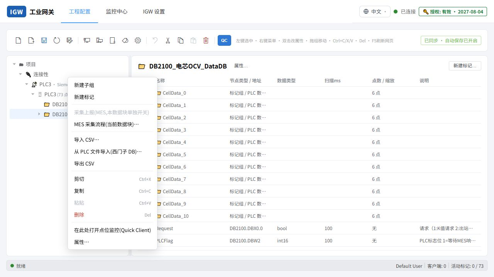

**图 10　从真实 DB 打开 QC 或 MES 流程。**

### 7.1 打开 QC

1. 在设备、DB/数据组上右键。
2. 选择“在此处打开点位监控（Quick Client）”。
3. QC 以独立工作窗口打开，可拖动、缩放、最小化和最大化。
4. MES 流程窗口可同时打开；点击哪个窗口，哪个窗口置于上层。

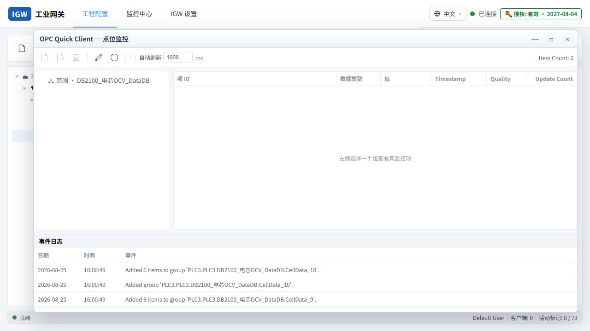

**图 11　QC 点位监控。**

### 7.2 读取状态

| 列 | 含义 |
|---|---|
| 项 ID | 完整路径：通道.设备.DB/组.标记 |
| 数据类型 | 运行时类型 |
| 值 | 最近一次读取到的值 |
| Timestamp | 数据采样或更新时刻 |
| Quality | Good、Uncertain 或 Bad |
| Update Count | QC 会话内更新次数 |

QC 不要求先创建 MES 流程。设备点位启用后可按扫描周期更新；自动刷新关闭时可点击刷新按钮主动读取。

### 7.3 写入值

1. 选择一个可写标记。
2. 双击“值”单元格，或点击写入工具按钮。
3. 在置顶的写入对话框中输入值。
4. 确认类型和目标完整路径。
5. 点击写入，等待质量和更新时间更新。

字符串超过 PLC 声明长度时，IGW 按 PLC 字符串长度安全截断，避免后续字段被覆盖。数值必须在目标数据类型范围内；校验失败时不执行写入。

### 7.4 数组调试

- 在数组查看器中填写起始位置和长度，只加载可见切片。
- 可写单个元素或当前切片，不需要展开整个数组。
- 百万级点位场景不要选择“全部展开”；优先按业务结构、工位、DB 和切片定位。
- 部分元素 Bad 时，Good 元素仍显示真实值；字符串 Bad 可显示 `Bad`，其他上报类型使用 `null`，避免用 0 或 false 掩盖异常。

---

## 8. MES 采集流程

### 8.1 创建入口与空流程

只在具体 DB/数据组上右键进入“MES 采集流程”。新建任务默认是空画布，不再自动创建一套流程。若选择流程模板，系统提示是否用模板覆盖当前画布；确认后套用，取消则保留现有内容。

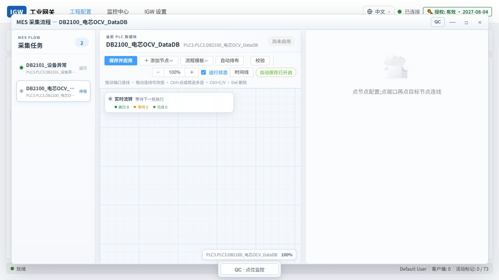

**图 12　MES 采集流程工作区。** 左侧是当前真实 DB 的任务列表，中间是画布，右侧是选中节点的详细配置。三栏可调整，窗口本身可拖动和缩放。

### 8.2 节点与连线

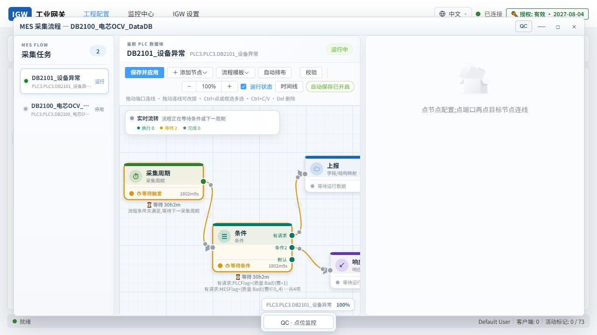

**图 13　典型流程：采集周期 → 条件 → 上报 → 响应直写。**

| 节点 | 作用 | 关键配置 |
|---|---|---|
| 采集周期 | 启动每一轮采集 | 周期；条件未满足时按周期重新读取 |
| 条件 | 根据 PLC 当前值选择出口 | 多分支、每分支多条件、“全部/任一” |
| 上报 | 读取范围、组装 JSON、调用 HTTP | 地址、超时、数据范围、字段别名、成功判定 |
| 判成败 | 根据响应字段分成功/失败 | 字段、比较符、期望值 |
| 响应直写 | HTTP 业务成功后把响应写回 PLC | 自动映射、上报别名反向映射、自定义写入 |
| 成功/失败回写 | 在不同分支写固定值或复制点位 | 目标点、固定值/来源点、读回确认 |
| 延时 | 延后进入下一节点 | 毫秒数 |

连线方法：拖动源节点端口到目标节点端口。条件节点可从不同分支端口连出；未命中任何分支时走“默认”口。拖动连接线可改变连接，选中后按 Delete 删除。

### 8.3 采集周期语义

- 采集周期节点不需要额外触发条件。
- 条件不满足：等待到下一采集周期重新读取，不执行后续节点。
- 条件满足：进入上报，必须等待上报和后续回写完成后才开始下一轮。
- HTTP 等待默认 30 秒；超时后取消本次请求、释放连接并按流程错误策略等待下一轮。
- 同一任务不会因为周期短而重入；上一轮没有结束时不会重复启动下一轮。

### 8.4 条件配置

点位选择框会自动列出当前 DB 的点位，并显示路径、类型和当前值。支持跨 DB、跨设备选择；另一个 PLC 离线时，对应值按 Bad/null 处理，不阻塞其他在线 PLC 的数据。

操作符：

| 操作符 | 填写方式 | 示例 |
|---|---|---|
| `=`、`≠`、`>`、`≥`、`<`、`≤` | 一个期望值 | `PLCFlag = 1` |
| `∈任一` | 逗号分隔多个值，中英文逗号均可 | `MESFlag ∈ 0,4` |
| `变化` | 不填期望值 | SN 变化时触发 |
| `正则` | 正则表达式 | 条码格式判断 |

同一分支中的多条件全部满足才命中；多个分支按从上到下选择第一个满足的出口。当前实际值和质量会显示在节点归因面板中。

### 8.5 上报字段与结构体

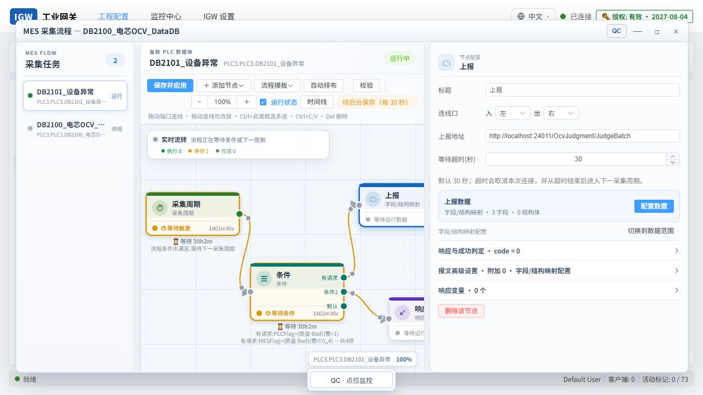

**图 14　上报节点右侧详细设置。** 内容按基础配置、上报数据、结构体/数组、响应与成功判定、高级选项分区，避免长表单挤压画布。

两种数据组织模式可以切换且互不清空：

1. **数据范围**：选择完整 DB、结构体或数组，适合大结构自动上报。
2. **字段映射**：逐点设置 JSON 字段名，适合接口字段与 PLC 名不同的业务。

JSON 名称默认与 PLC 名称一致，允许自定义。结构体数组可设置 JSON 数组名、起始下标和数量。套用模板时，系统把模板中的来源路径重写为当前 DB；找不到的来源从上报配置中清理，但画布节点与连线保留。

质量策略：

- Good：上报实际值。
- Bad 字符串：上报字符串 `"Bad"`，便于接口和日志直接识别。
- Bad 的数值、布尔、日期等：上报 JSON `null`，不使用 0/false 冒充有效值。
- 同一结构中部分 Good、部分 Bad：逐字段处理，不因一个 Bad 放弃全部 Good 数据。

### 8.6 HTTP 成功与业务成功

新建上报节点默认：

- 成功字段：`httpStatusCode`
- 成功值：`200`
- 超时：30 秒

必须同时区分：

1. **传输成功**：HTTP 请求收到了响应，例如 HTTP 200。
2. **业务成功**：响应 JSON 中 `isSuccess=true`，或用户配置的成功字段满足期望。

HTTP 200 但 `isSuccess=false` 仍属于业务失败，应停留在上报节点，不继续执行成功方向。异常详情显示在上报节点；响应直写节点只显示自己的映射或 PLC 写入异常。

推荐响应格式：

```json
{
  "httpStatusCode": 200,
  "isSuccess": true,
  "backResult": {
    "mesFlag": 4,
    "plcFlag": 1,
    "temperature": 25,
    "structures": [
      {
        "dmcCode": "CELL001",
        "kValue": 0.00088,
        "voltage": 3580,
        "isNg": 1,
        "ngReason": "NG reason",
        "errorInfo": ""
      }
    ]
  },
  "errorMessage": null,
  "exceptionMessage": null
}
```

### 8.7 响应直写与反向映射

响应直写只在 HTTP/业务成功时执行；非 200 或业务失败不会向后执行。自动映射优先读取 `backResult`，并复用上报配置建立的字段别名反向映射：例如 PLC 的 `ErrorMessage` 上报时命名为 `ngReason`，返回中的 `ngReason` 可自动写回原 `ErrorMessage`。

写回规则：

- 对象字段按名称/别名匹配。
- `structures` 等列表按配置的起始和数量写回对应结构体元素。
- 单个字段类型不兼容或写入失败，只记录该字段失败，不阻止其他字段写回。
- 字符串过长按 PLC 长度截断。
- 还可增加自定义映射、固定值或“从另一个 PLC 点复制”。
- 固定 MESFlag 回写与响应结构回写是两套写项，均应在运行详情中逐项显示下发值、结果和读回值。

### 8.8 模板

流程模板是当前任务的深拷贝，不与原任务保持动态绑定。正确用法：

1. 在一个完整 DB 上配置并验证流程。
2. 保存为流程模板，填写清晰名称和说明。
3. 打开另一个结构兼容的 DB。
4. 选择模板；系统提示将替换当前画布。
5. 确认后检查当前 DB 的上报字段、结构体、条件和回写目标。
6. 校验并保存应用。

若目标 DB 结构不同，系统保留通用画布，清理不存在的数据范围并提示重新选择，避免保存后无法再次打开。

### 8.9 运行状态

- 灰：等待条件或等待下一周期，不是异常。
- 绿：正在执行或本轮成功。
- 黄：等待/执行提示或慢于历史基线。
- 橙：真正执行停滞，超过阈值。
- 红：节点失败、通信错误或回写失败。

顶部“时间线”显示最近节点流转；每任务仅在内存保留最近 256 条，服务重启后清空。

---

## 9. 监控中心与故障定位

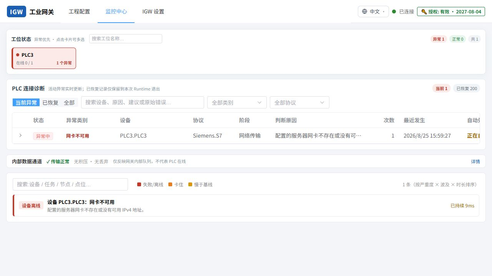

**图 15　监控中心。** 顶部工位卡按异常优先排序；点击卡片任意位置可多选，选中卡片以颜色和边框突出显示，顶部显示“已选 N 个”并可清空筛选。未选择表示显示全部。

### 9.1 监控语义

| 颜色 | 含义 | 用户动作 |
|---|---|---|
| 红 | 设备离线、节点失败、重试中 | 立即处理 |
| 橙 | 执行卡住 | 查看持续时间、P95 和目标系统 |
| 黄 | 慢于历史基线 | 观察性能趋势 |
| 绿 | 正常 | 无需操作 |

等待来料、等待 PLC 标志或等待条件不是异常，无论等待多久都不进入异常队列。只有处于执行状态的上报、回写、延时等节点超过阈值才判定卡住。

### 9.2 P95 与卡住

系统在线学习节点单次执行耗时 P95：

- 样本不足 20 次时不启用自动卡住判定。
- 超过 P95 显示“慢于基线”。
- 超过 P95 × 3 判定“卡住”。
- 可为节点设置手工卡住阈值，手工值优先。

“P95 已达到 2048 ms”表示最近执行中 95% 的耗时不超过约 2.048 秒，不代表页面必然卡死。若百万点场景持续上升，应检查扫描合并、PLC PDU、网卡、并发上报和 QC 展开范围。

### 9.3 连接故障分类

| 类别 | 典型原因 | 排查顺序 |
|---|---|---|
| 网卡不可用 | 选中的网卡被禁用、IPv4 改变或迁移到另一台服务器 | 重新选择网卡 → 保存 → 通道级立即重连 |
| 网络不可达 | 路由、掩码、交换机/VLAN、网线、IP 冲突 | `ping`、ARP、`Test-NetConnection`、交换机端口 |
| 端口拒绝/超时 | PLC 服务未开启、防火墙、端口错误 | 验证目标 TCP/UDP 端口 |
| 协议握手失败 | 型号、Rack/Slot、Unit Id、FINS 节点、CPU Path 不正确 | 对照 PLC 工程和协议参数 |
| 安全/认证失败 | S7 Plus 权限、OPC UA 策略/证书、用户名密码 | 查看错误码，配置认证或信任证书 |
| DB/地址不支持 | DB 不存在、偏移越界、优化访问与协议不匹配 | 用普通变量验证，再核对 DB 与地址 |
| 部分数据异常 | 一个 DB 或部分 Tag 失败 | QC 定位 Bad 点；其他 Good 点继续采集 |

通道诊断与工程树必须使用同一运行状态，避免“诊断说离线但树显示在线”。点击异常条目的“定位画布”可打开对应任务并聚焦根因节点。

---

## 10. IGW 设置

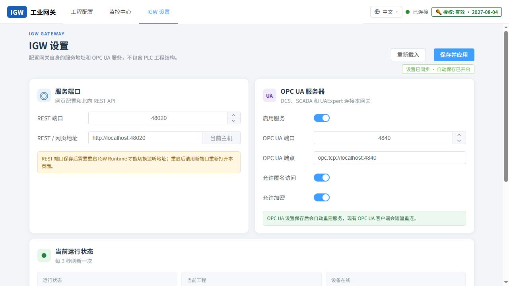

**图 16　IGW 设置页面。**

主要设置：

- Web 访问端口：默认 48020，是 IGW Web 管理端和 API 的监听端口。
- 运行参数：扫描调度、超时、日志等网关级配置。
- 网络适配器：全局默认值；通道可以显式覆盖。
- 授权与激活：机器码、授权码和有效期。
- 语言：中文/English，偏好写入数据库持久化。

设置页同样后台静默保存。修改 Web 端口、服务监听或安全配置后，按界面提示重启服务；修改前确认新端口未被占用并更新防火墙规则。

---

## 11. REST API 与 Swagger

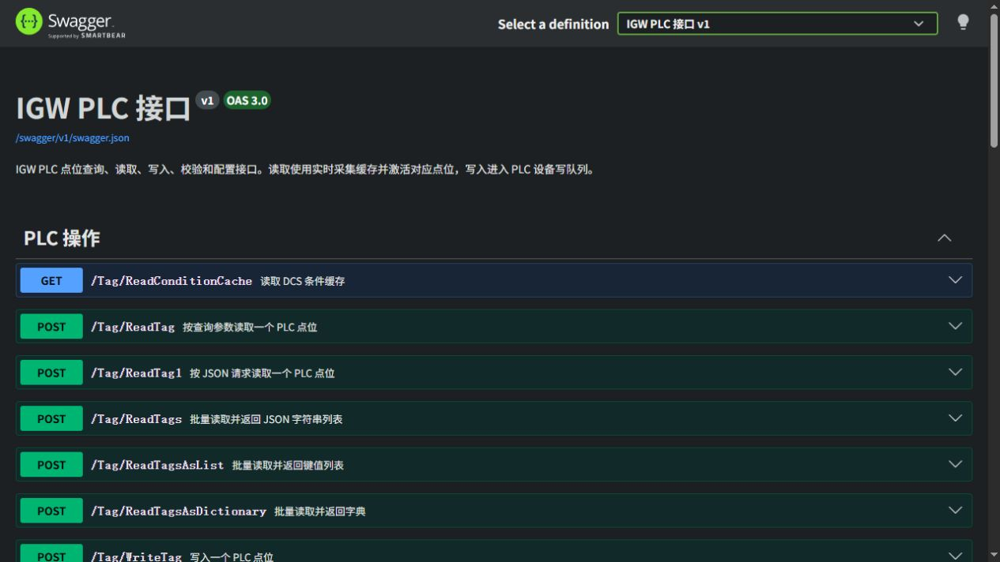

**图 17　IGW PLC 接口 Swagger。** 访问 `http://服务器IP:48020/swagger/index.html`。

### 11.1 对外接口范围

Swagger 标题为“IGW PLC 接口”，分组为“PLC 操作”。主要接口：

| 方法与路径 | 说明 |
|---|---|
| `GET /Tag/ReadConditionCache` | 读取条件缓存 |
| `POST /Tag/ReadTag?tag=...` | 查询参数读取单点 |
| `POST /Tag/ReadTag1` | JSON 请求读取单点 |
| `POST /Tag/ReadTags` | 批量读取，返回 JSON 字符串列表 |
| `POST /Tag/ReadTagsAsList` | 批量读取，返回键值列表 |
| `POST /Tag/ReadTagsAsDictionary` | 批量读取，返回字典 |
| `POST /Tag/ReadTagsWithQuality` | 批量读取，逐点返回值、质量和原因（单个坏点不影响其它点，见 `docs/dcs-read-quality.md`） |
| `POST /Tag/WriteTag` | 写入单点 |
| `POST /Tag/WriteTags` | 批量写入 |
| `POST /Tag/GetTagValueTypeByTagName` | 获取类型 |
| `POST /Tag/CheckTagValueValidity` | 仅校验写入值，不执行写入 |
| `POST /Tag/AddTags` | 按模型添加或更新标记 |
| `GET /api/v1/tags/{id}/array` | 读取逻辑数组 |
| `GET /api/v1/tags/{id}/array/slice` | 按起始和长度读取切片 |
| `PUT /api/v1/tags/{id}/array/slice` | 写入数组切片 |

### 11.2 读单点示例

```powershell
$body = @{ tag = 'PLC3.PLC3.DB2101_设备异常.PLCFlag' } | ConvertTo-Json
Invoke-RestMethod `
  -Method Post `
  -Uri 'http://localhost:48020/Tag/ReadTag1' `
  -ContentType 'application/json' `
  -Body $body
```

### 11.3 写单点示例

```powershell
$body = @{
  tag = @{
    key   = 'PLC3.PLC3.DB2101_设备异常.MESFlag'
    value = 2
  }
} | ConvertTo-Json -Depth 5

Invoke-RestMethod `
  -Method Post `
  -Uri 'http://localhost:48020/Tag/WriteTag' `
  -ContentType 'application/json' `
  -Body $body
```

### 11.4 批量读取示例

```json
[
  "PLC3.PLC3.DB2101_设备异常.PLCFlag",
  "PLC3.PLC3.DB2101_设备异常.MESFlag"
]
```

发送到 `/Tag/ReadTagsAsDictionary`。响应统一包含 `httpStatusCode`、`isSuccess`、`backResult`、`errorMessage` 和 `exceptionMessage`。

`ReadTags`、`ReadTagsAsList`、`ReadTagsAsDictionary` 只要有一个点没注册或质量不好，整个请求就失败。需要逐点判断时，把同样的数组发到 `/Tag/ReadTagsWithQuality`，每个点单独返回 `isGood`、`statusCode`、`status`、`timestampUtc` 和原因分类 `reason`（`SymbolNotFound`、`CommFailure`、`Timeout`、`WaitingForData`、`NotRegistered`、`AccessDenied`、`DeviceError`）。

### 11.5 安全与权限

当 IGW 安全功能关闭时，PLC 操作 API 不额外要求登录。启用安全后，`/api/v1` 范围按照用户读分支和写权限判断；写接口需要可写权限。生产网络不应把 48020 直接暴露到公网，建议通过 VLAN、防火墙、反向代理和最小权限账户限制访问。

---

## 12. 备份、迁移与恢复

### 12.1 建议备份内容

1. 从 Web 导出的 JSON 配置。
2. `C:\ProgramData\IGW\project.igwproj`。
3. `C:\ProgramData\IGW` 下数据库和日志（排障时需要）。
4. OPC UA `pki` 目录（保留已建立的信任关系）。
5. 授权文件仅按授权策略备份；不要备份授权私钥到运行服务器。

### 12.2 迁移到另一台电脑

1. 在旧机保存并应用，然后导出 JSON。
2. 在新机安装相同或更高版本 IGW。
3. 导入 JSON 并检查网卡、IP、端口和协议没有改变。
4. 重新输入不随工程导出的本机保护凭据。
5. 为新机器单独授权。
6. 先用 QC 读普通点，再测试数组/结构体和 MES 回写。

### 12.3 恢复原则

- 优先恢复 JSON 配置；只有需要完整本机状态时才恢复整个 ProgramData 目录。
- 不要用旧机网卡标识覆盖新机后直接运行；先选择新机实际网卡。
- 若导入后某流程引用的目录已删除，系统删除失效任务；结构变化则保留画布并清理失效上报范围。

---

## 13. 常见问题与处理清单

### 13.1 Ping 通但 IGW 离线

1. 确认 IP 是否写错，例如 `192.168` 与 `192.169` 不同。
2. 使用 `Test-NetConnection <PLC_IP> -Port 102` 或协议实际端口。
3. 检查通道绑定网卡是否属于 PLC 网段。
4. 检查 PLC 型号、Rack/Slot、协议模式、安全设置。
5. 使用通道右键“诊断”，查看网络/协议/安全/地址分类。
6. 点击通道级“立即重连”，不要删除设备重建。

### 13.2 时断时连

- 检查重复 IP、Wi-Fi 漫游/省电、双网卡路由变化、交换机端口和网线。
- 确认只有一个客户端占用不允许多会话的 PLC 资源。
- 减少极短周期的零散请求，使用连续块/逻辑数组读取。
- 查看日志中的首次错误，不要只看后续重试失败。
- 自动重连会重建整个通道，但不会停止其他通道。

### 13.3 工程树在线，但 QC 没值

- 在线可能只表示会话建立；检查具体 Tag 的 Quality。
- 确认标记启用、扫描周期有效，或在 QC 中执行主动刷新。
- 检查地址和类型，特别是 DBW/DBD、字符串长度、优化 DB 和符号地址。
- 一个 DB 部分地址失败时，展开 QC 找出 Bad 点；Good 点仍应继续更新。

### 13.4 OPC UA 已浏览到节点，但仍显示待机

- 浏览成功只证明可建立浏览会话；确认导入标记已经保存并应用。
- 端点配置在通道，不在设备；设备下应有启用标记。
- 检查订阅/读取状态、NodeId、命名空间索引或字符串 NodeId 是否稳定。
- 服务器移动节点时 NodeId 可能真的改变；仅移动 IGW 工程文件夹不应改变协议 NodeId。

### 13.5 MES 上报 HTTP 200 仍失败

- 查看响应中的 `isSuccess`、`errorMessage` 和 `exceptionMessage`。
- 默认成功判定为 `httpStatusCode=200`；业务接口返回 false 时仍停在上报节点。
- 数据库异常、参数为空、数组越界等属于接口业务失败，不应由响应直写节点承担。

### 13.6 返回结构没有写回 PLC

1. 确认上报节点业务成功。
2. 确认响应业务对象位于 `backResult` 或已配置正确响应路径。
3. 检查上报字段别名能否反向匹配 PLC 字段。
4. 检查结构体数组起始和数量。
5. 在运行详情中逐字段查看类型转换、截断、PLC 写入和读回结果。
6. 单字段失败不应阻止其他字段；若全部失败，先在 QC 中手工写同一目标点。

### 13.7 中文乱码

- 西门子 STRING 常见为单字节编码；WSTRING 为 Unicode。
- IGW 按标记类型和配置执行解码，并对常见中文编码做兼容识别；无法可靠自动判断时应显式配置编码。
- KEPServer 的显示结果取决于驱动、PLC 字符串类型和项目字符集，不存在对所有协议统一的单一编码。
- 写入前确认 PLC 分配长度；超长内容会被截断。

### 13.8 百万点与 10 ms 周期

- 一百万点通常分布在多个 PLC、多个 DB 和约 50 个工位，不应串行逐点读取。
- 运行时应按设备并行、按协议连续地址合并、按任务周期调度。
- 10 ms 任务只适合少量高优先级点；几百点任务也要结合 PLC 扫描周期、PDU、网卡和 CPU 实测。
- QC 只显示搜索结果或切片，不一次渲染所有元素。
- 关闭不需要的历史记录，使用监控中心观察 P95、错误率和重连次数。

---

## 附录 A：上线验收清单

### A.1 网络与服务

- [ ] IGW Gateway 服务自动启动。
- [ ] 48020 页面仅在允许的网络范围开放。
- [ ] 每个通道绑定正确网卡。
- [ ] PLC IP、端口、路由、掩码无冲突。
- [ ] 断网恢复后无需删除设备，可自动或手动重连。

### A.2 工程与数据

- [ ] JSON 导出后在测试机回导，协议和 MES 流程完整。
- [ ] 每个 MES 流程绑定具体 DB/业务顶层目录。
- [ ] 普通点、字符串、数组、结构体数组均在 QC 验证。
- [ ] 部分 Bad 时 Good 数据仍可用。
- [ ] 中文读取、写入和字符串截断符合 PLC 定义。

### A.3 MES 闭环

- [ ] 条件不满足时只等待下一周期。
- [ ] 上报失败或业务 NG 时停在上报节点。
- [ ] HTTP 超时后释放连接并进入下一周期策略。
- [ ] 返回 `backResult` 能按别名回写结构体。
- [ ] 单字段失败不阻断其他字段写回。
- [ ] MESFlag、ErrorInfo/ErrorMessage 和业务数组均读回确认。

### A.4 运行与运维

- [ ] 监控中心能区分网络、协议、安全、地址和部分数据异常。
- [ ] 异常卡片可搜索、多选和清空筛选。
- [ ] 日志目录纳入磁盘容量监控。
- [ ] 已保存 ProgramData 与 JSON 双份备份。
- [ ] 授权状态和到期提醒已确认。

---

## 附录 B：技术支持时需要提供的信息

为减少来回沟通，提交问题时请提供：

1. IGW 版本号和 Windows 版本。
2. 协议、PLC 型号、目标 IP/端口（敏感网段可脱敏）。
3. 通道诊断中的故障分类、首次错误码和发生时间。
4. 失败 Tag 的完整路径、地址、类型和 Quality。
5. QC 能否读取普通变量、能否手工写入同一目标点。
6. MES 上报请求结构、HTTP 状态和脱敏后的响应 JSON。
7. `%ProgramData%\IGW\logs` 对应时间段日志。
8. 可复现的最小 JSON 工程；删除授权码、密码、Token 和生产数据。

---

**文档维护说明**：功能以当前 master 的 1.5.94 源码与 Web 页面为准。每次发布新安装包后，应至少更新版本号、协议字段、接口列表、截图和故障表，并执行一次“安装—导入—QC—MES 上报—PLC 回写—监控”的完整验收。
